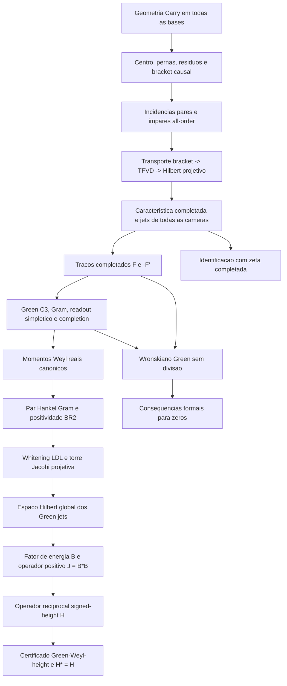

# Cadeia formal de dependencias da teoria Carry ao operador auto-adjunto

Este documento e um indice positivo das construcoes e dos teoremas formalizados no
commit `7c5185f` de `carry-self-adjoint-operator`, juntamente com as dependencias
Lean fixadas por esse commit. Ele registra somente objetos e resultados presentes
no codigo. A ausencia de um item neste indice nao constitui uma afirmacao sobre o
seu status matematico ou formal.

Todos os nomes entre crases sao declaracoes Lean pesquisaveis literalmente. Os
links apontam para o arquivo que contem a declaracao ou para o repositorio externo
fixado no `lake-manifest.json`.

## 1. Mapa global



A espinha dorsal pode ser lida como a composicao:

```text
cameraBracketIncidence
  -> br2CameraBracketTfvdAnalysisMap
  -> br2CameraBracketProjectiveHilbertMap
  -> completedPackagedFiniteNativeOperatorJet
  -> completedNativeOperatorCharacteristic
  -> (F, -F')
  -> completed Green parity jets
  -> real logarithmic Weyl moments
  -> Hankel/shifted Gram pair
  -> canonical finite Jacobi tower
  -> completed Green-jet Hilbert space
  -> J = B*B
  -> reciprocal signed-height operator
  -> maximal self-adjoint height operator
```

## 2. Dependencias formais fixadas

| Camada externa | Repositorio e revisao fixada | Papel na cadeia |
|---|---|---|
| Geometria Carry | [`carry-geometry@1f85b8c`](https://github.com/thiagomassensini/carry-geometry/tree/1f85b8c3ab5ded27a0782956e1ada0dd8a1b6fd4) | Cameras, centros, pernas, bracket e geometria em todas as bases. |
| Crosswalk C3 | [`native-carry-c3-crosswalk@150cfc7`](https://github.com/thiagomassensini/native-carry-c3-crosswalk/tree/150cfc7fb08da96bf8117f15869cc2b819d593c2) | Carta C3, Genuine, par de bordo Green e identidades de crosswalk. |
| TFVD e continuacao | [`primos@65d50f6`](https://github.com/thiagomassensini/primos/tree/65d50f6db1208708e109982ba97e1d51d3039956) | TFVD nativa, continuacao Genuine, chart bracketado e interfaces analiticas. |
| Weyl espectral | [`native-carry-spectral-weyl@298d83c`](https://github.com/thiagomassensini/native-carry-spectral-weyl/tree/298d83c9351e308a5213b9f5ac32e44087f98a9f) | Gerador logaritmico, momentos, whitening e realizacoes de Naimark. |
| Operador finito | [`finite-native-carry-operator@00e9d6b`](https://github.com/thiagomassensini/finite-native-carry-operator/tree/00e9d6beb17226545abf5ddf90bbfede6c7146b0) | Operador nativo finito e suas coordenadas por cutoff. |
| Frame Green | [`green-frame-theorem@cd2d838`](https://github.com/thiagomassensini/green-frame-theorem/tree/cd2d838bee67ad23f869a02f8ed9f0a0feb926fa) | Analise/sintese de frames, Gram e Hilbert carriers usados pelo Green. |

O recibo exato dessas revisoes esta em [`lake-manifest.json`](lake-manifest.json).

## 3. Evolucao nativa e bracket causal

| Arquivo | Declaracoes principais | Resultado formalizado |
|---|---|---|
| [`NativeLogEvolution.lean`](CarrySelfAdjointOperator/NativeLogEvolution.lean) | `NativeLogHilbert`, `nativeLogGenerator`, `nativeLogGenerator_isSelfAdjoint`, `nativeLogGenerator_basisVector` | Constroi o gerador nativo diagonal e prova auto-adjunticidade e a lei de autovalor logaritmica na base canonica. |
| [`CausalBracketStateUniqueness.lean`](CarrySelfAdjointOperator/CausalBracketStateUniqueness.lean) | `causalUnitBracket`, `rightLeg_eq_bracket_sub_left_add_two_center`, `rightLeg_eq_of_left_center_bracket_eq` | Reconstrucao exata da perna direita a partir do bracket, centro e perna esquerda. |
| mesmo arquivo | `causalUnitBracket_eq_slope_sub_slope`, `causalSlope_eq_initial_add_sum_brackets`, `state_eq_double_telescope` | Identidade de segunda diferenca, soma causal das inclinacoes e telescopagem dupla do estado. |
| mesmo arquivo | `CausalBracketData`, `causalBracketReconstruction`, `causalBracketReconstruction_realizes`, `causalBracketReconstruction_unique`, `existsUnique_realizesCausalBracketData` | Existencia e unicidade do estado que realiza os dados causais bracketados. |
| mesmo arquivo | `naturalCamera_first_centeredBracket_eq_causalUnitBracket`, `allBases_contains_causal_unit_cell`, `eq_on_ge_two_of_naturalCameraUnitBrackets_eq`, `eq_of_four_seed_eq_of_naturalCameraUnitBrackets_eq` | Identifica o bracket causal dentro do atlas natural de cameras e prova determinacao global por sementes e brackets. |
| [`BracketLegLatticeSeparation.lean`](CarrySelfAdjointOperator/BracketLegLatticeSeparation.lean) | `cameraSlope_dvd_alignedCenter`, `cameraSlope_not_dvd_leftBracketLeg`, `cameraSlope_not_dvd_rightBracketLeg`, `bracketCenter_on_lattice_and_legs_off_lattice` | Separa exatamente o centro alinhado das duas pernas na rede da camera. |
| mesmo arquivo | `bracketCenter_left_right_exactResidues`, `leftLeg_residue_eq_rightLeg_residue_iff_antipodal`, `naturalBracketLegs_not_dvd_camera`, `c2BracketLegs_not_even` | Calcula os residuos exatos e caracteriza o caso antipodal. |
| [`BracketResidueOrbit.lean`](CarrySelfAdjointOperator/BracketResidueOrbit.lean) | `BracketResidueChannels`, `alignedBracketResidueChannels_eq_normalForm`, `cameraResidueReflection`, `cameraResidueReflection_involutive` | Empacota os canais centro/pernas e constroi a reflexao ciclica involutiva. |
| mesmo arquivo | `centerResidueSector_disjoint_legResidueOrbit`, `alignedBracketResidueChannels_legPair_eq_orbit`, `legResidueOrbit_card_eq_two_iff_not_antipodal` | Separa setor central e orbita das pernas e calcula sua cardinalidade. |
| [`BracketResidueReflectionOperator.lean`](CarrySelfAdjointOperator/BracketResidueReflectionOperator.lean) | `cameraResidueReflectionOperator`, `cameraResidueReflectionOperator_involutive`, `cameraResidueReflectionOperator_isSymmetric` | Eleva a reflexao a um operador linear simetrico e involutivo. |
| mesmo arquivo | `cameraResidueEvenProjector`, `cameraResidueOddProjector`, `inner_cameraResidueEvenProjector_cameraResidueOddProjector`, `cameraResidueReflectionOperator_bracket`, `cameraResidueReflectionOperator_orientedLeg` | Constroi os projetores ortogonais par/impar; bracket e diferenca orientada ocupam os setores correspondentes. |

## 4. Incidencias all-order e transporte TFVD/Hilbert

| Arquivo | Declaracoes principais | Resultado formalizado |
|---|---|---|
| [`AllBaseBracketIncidenceIndependence.lean`](CarrySelfAdjointOperator/AllBaseBracketIncidenceIndependence.lean) | `cameraBracketIncidence`, `cameraBracketIncidence_linearIndependent_of_injective` | Define a incidencia bracketada de camera e seu criterio injetivo de independencia. |
| mesmo arquivo | `evenCameraBracketIncidence_linearIndependent`, `oddCameraBracketIncidence_linearIndependent`, `evenCameraBracketIncidence_linearIndependent_global`, `oddCameraBracketIncidence_linearIndependent_global` | Independencia linear finita e global das familias par e impar, indexadas por `Nat`. |
| [`BR2BracketIncidenceIndependence.lean`](CarrySelfAdjointOperator/BR2BracketIncidenceIndependence.lean) | `br2CameraBracketIncidence`, `br2CameraBracketIncidence_linearIndependent_of_injective`, `br2EvenCameraBracketIncidence_linearIndependent`, `br2OddCameraBracketIncidence_linearIndependent` | Especializa a independencia de incidencias ao regime BR2. |
| [`BR2BracketTfvdIncidenceTransport.lean`](CarrySelfAdjointOperator/BR2BracketTfvdIncidenceTransport.lean) | `br2RealIncidenceComplexification`, `br2RealIncidenceComplexification_injective`, `nativeGpreCanonicalVerticalRealization_cameraBracketIncidence` | Complexifica sem perda a incidencia real e a identifica com a realizacao vertical TFVD. |
| mesmo arquivo | `br2CameraBracketTfvdAnalysisMap`, `br2CameraBracketTfvdAnalysisMap_injective`, `br2CameraBracketTfvdParityJet`, `br2CameraBracketTfvdIncidenceJetTransport` | Constroi o transporte linear injetivo incidencia -> jets TFVD. |
| mesmo arquivo | `br2CameraBracketTfvdParityJet_even_linearIndependent`, `br2CameraBracketTfvdParityJet_odd_linearIndependent` | Transporta a independencia all-order aos jets TFVD pares e impares. |
| [`BR2ProjectiveHilbertIncidenceTransport.lean`](CarrySelfAdjointOperator/BR2ProjectiveHilbertIncidenceTransport.lean) | `CanonicalCompletedTfvdGreenHilbertCarrier`, `br2CameraBracketProjectiveHilbertMap`, `br2CameraBracketProjectiveHilbertMap_injective` | Fixa o portador Hilbert concreto `CarryVerticalL2` e injeta nele as incidencias. |
| mesmo arquivo | `br2CameraBracketProjectiveHilbertParityJet`, `br2CameraBracketProjectiveHilbertIncidenceJetTransport` | Realiza os jets de paridade no Hilbert projetivo. |
| mesmo arquivo | `br2FiniteTfvdHilbertRecovery`, `br2FiniteTfvdHilbertRecovery_comp_analysisMap`, `br2FiniteTfvdHilbertRecovery_parityJet` | Prova reconstrucao finita exata do estado TFVD a partir do portador Hilbert. |
| mesmo arquivo | `br2CameraBracketProjectiveTfvdParityJet`, `br2CameraBracketProjectiveTfvdIncidenceJetTransport`, `br2CameraBracketProjectiveTfvdParityJet_compatible` | Costura a realizacao projetiva e a TFVD com compatibilidade entre cutoffs. |
| [`BR2IncidenceStrictPositivity.lean`](CarrySelfAdjointOperator/BR2IncidenceStrictPositivity.lean) | `BR2BracketIncidenceJetTransport`, `BR2BracketIncidenceJetTransport.even_linearIndependent`, `BR2BracketIncidenceJetTransport.odd_linearIndependent` | Interface abstrata linear/injetiva e transporte da independencia das incidencias para familias completas de jets. |
| mesmo arquivo | `CanonicalCompletedNativeBR2IncidenceJetTransport`, `BR2CenterLegGreenMomentCertificate.toRealMomentKernel`, `BR2CenterLegGreenMomentCertificate.hankelPair_posDef_of_incidenceTransport` | Tipagem do transporte para o estado Green completado e positividade definida do par Hankel BR2. |

## 5. Operador finito, completion e todas as cameras

| Arquivo | Declaracoes principais | Resultado formalizado |
|---|---|---|
| [`BR2RealComplexAllOrderBridge.lean`](CarrySelfAdjointOperator/BR2RealComplexAllOrderBridge.lean) | `iteratedDeriv_continuousLinearEquiv_comp`, `packaged_iteratedDeriv_finiteNativeOperator_eq_along_nativeLine`, `packaged_iteratedDeriv_finiteNativeOperator_eq_complex` | Converte exatamente os jets reais do operador finito em jets complexos, em toda ordem. |
| mesmo arquivo | `completedPackagedFiniteNativeOperatorJet`, `completedPackagedFiniteNativeOperatorJet_eq_complex`, `completedPackagedFiniteNativeOperatorJet_eq_along_nativeLine`, `completedPackagedFiniteNativeOperatorJet_cutoff_invariant` | Define o jet completado e prova suas identificacoes complexa/real e independencia do cutoff. |
| [`CompletedNativeCharacteristic.lean`](CarrySelfAdjointOperator/CompletedNativeCharacteristic.lean) | `completedNativeCharacteristic`, `completedNativeCharacteristic_eq_bracketCharacteristic`, `completedNativeCharacteristic_eq_factor_mul_nativeScalar`, `completedNativeCharacteristic_cutoff_independent` | Constroi a caracteristica completada por cabeca e cauda, identifica-a com bracket e escalar nativo vestido, e prova independencia de cutoff. |
| [`CompletedOperatorCharacteristic.lean`](CarrySelfAdjointOperator/CompletedOperatorCharacteristic.lean) | `operatorHeightParameter`, `nativeXiCompletionFactor`, `completedNativeOperatorCharacteristic`, `nativeXiCompletionFactor_mul_completedNativeCharacteristic` | Define o parametro real de altura, o fator xi e a caracteristica canonica do operador. |
| [`CompletedNativeAllOrderCameraBridge.lean`](CarrySelfAdjointOperator/CompletedNativeAllOrderCameraBridge.lean) | `operatorHeightParameter_ofReal_eq_nativeLine`, `completedPackagedFiniteNativeOperatorJet_eq_completedNativeCharacteristic` | Identifica o jet de camera completado com a caracteristica nativa na linha real de alturas. |
| mesmo arquivo | `completedNativeCharacteristic_nativeLine_eq_zero_iff`, `completedPackagedFiniteNativeOperatorJet_zero_eq_zero_iff`, `completedPackagedFiniteNativeOperatorJet_zero_camera_independent` | Prova igualdade exata dos conjuntos de zeros completados entre cameras e independencia de camera. |
| mesmo arquivo | `iteratedDeriv_nativeXiCompletionFactor_mul_completedNativeCharacteristic_eq`, `iteratedDeriv_completedXiDressedCamera_cutoff_independent` | Identidade all-order vestida pelo fator xi e independencia de cutoff para todo jet. |
| [`NativeScalarZetaIdentification.lean`](CarrySelfAdjointOperator/NativeScalarZetaIdentification.lean) | `bracketCharacteristic_three_eq_bracketedDirichletChart`, `nativeScalar_eq_genuineContinuation`, `nativeScalar_eq_riemannZeta`, `completedNativeOperatorCharacteristic_eq_completedRiemannZeta` | Identifica chart C3, continuacao Genuine, zeta de Riemann e caracteristica completada no dominio formalizado. |

## 6. Cabeca, cauda, valor e companheiro de bordo

| Arquivo | Declaracoes principais | Resultado formalizado |
|---|---|---|
| [`CompletedProductJet.lean`](CarrySelfAdjointOperator/CompletedProductJet.lean) | `nativeHeightScalar`, `nativeHeightScalarBoundaryCompanion`, `nativeXiCompletionBoundaryCompanion`, `productBoundaryCompanion_negDeriv` | Define o valor nativo em altura e os companheiros de bordo, com a regra do produto para `-F'`. |
| mesmo arquivo | `nativeXiCompletionFactor_ne_zero`, `completedNativeOperatorBoundaryCompanion_eq_product` | Prova nao anulacao do fator de completion no strip e identifica o companheiro completo com o produto. |
| [`CompletedEnrichedTfvdBoundaryCompanion.lean`](CarrySelfAdjointOperator/CompletedEnrichedTfvdBoundaryCompanion.lean) | `finiteCanonicalLogBracketChart_eq_neg_deriv_valueChart`, `canonicalC3LogJetCutoffTail_eq_neg_deriv_valueTail` | Identidade finita exata entre log-jet e derivada negativa do canal de valor, incluindo a cauda. |
| mesmo arquivo | `canonicalCompletedC3EnrichedTfvdLogJetTailReadout_eq_neg_deriv`, `canonicalCompletedC3EnrichedTfvdBoundaryCompanion_eq_neg_deriv` | Passa a identidade ao readout TFVD enriquecido completado. |
| mesmo arquivo | `canonicalCompletedC3EnrichedTfvdNormalizedValueTailReadout_eq_nativeHeightScalar`, `canonicalCompletedC3EnrichedTfvdCompletedValueTailReadout_eq_characteristic` | Identifica os readouts de valor normalizado e completado com o escalar nativo e a caracteristica. |
| mesmo arquivo | `canonicalCompletedC3EnrichedTfvdBoundaryCompanion_eq_completedNativeOperatorBoundaryCompanion` | Prova que o companheiro TFVD concreto e exatamente o companheiro canonico do operador. |

## 7. Portador C3, seis cameras e Green simpletico

| Arquivo | Declaracoes principais | Resultado formalizado |
|---|---|---|
| [`CanonicalEnrichedC3Port.lean`](CarrySelfAdjointOperator/CanonicalEnrichedC3Port.lean) | `canonicalEnrichedC3SourcePort`, `canonicalCompletedOperatorC3State` e seus teoremas `*_ne_zero` | Constroi a fonte C3 enriquecida e o estado completado concreto, preservando valor, log-jet e proveniencia. |
| [`GreenDirectSumState.lean`](CarrySelfAdjointOperator/GreenDirectSumState.lean) | `BinaryHilbertSum`, `weightedProductGreenState`, `inner_weightedProductGreenState`, `weightedProductGreenState_ne_zero_of_right`, `HasDivisionFreeGreenRepresentation.mul` | Realiza a regra de produto Green numa soma direta Hilbert com canais separados. |
| [`CompletedNativeC3LedgerState.lean`](CarrySelfAdjointOperator/CompletedNativeC3LedgerState.lean) | `CanonicalCompletedC3HilbertCarrier`, `canonicalCompletedOperatorC3HilbertState`, `completedNativeC3ProductLedgerState` | Fixa o portador C3 completado e constroi o ledger de produto no Hilbert concreto. |
| mesmo arquivo | `completedNativeC3ProductLedgerState_fst`, `completedNativeC3ProductLedgerState_snd`, `completedNativeC3ProductLedgerState_ne_zero` | Identifica individualmente os dois canais do ledger e prova nao anulacao do estado. |
| [`CanonicalC3SixCameraSource.lean`](CarrySelfAdjointOperator/CanonicalC3SixCameraSource.lean) | `firstC3CameraIndex`, `secondC3CameraIndex`, `canonicalC3RealCameraFinsupp`, `canonicalC3ImagCameraFinsupp` | Codifica as seis cameras `2,3,4,5,6,7` e separa quadraturas real e imaginaria. |
| mesmo arquivo | `canonicalC3CameraFinsuppPair_injective`, `canonicalC3SixCameraSourceMap`, `canonicalC3SixCameraSourceMap_injective`, `canonicalCompletedC3SixCameraSource_ne_zero` | Prova que o empacotamento de seis cameras e injetivo e preserva estado nao nulo. |
| [`CanonicalC3SymplecticNaimarkBridge.lean`](CarrySelfAdjointOperator/CanonicalC3SymplecticNaimarkBridge.lean) | `canonicalC3SymplecticCameraPacking`, `canonicalC3SymplecticCameraPacking_injective`, `realifiedGreenSkew_canonicalC3SymplecticCameraPacking` | Constroi o empacotamento simpletico e prova preservacao exata do skew Green. |
| mesmo arquivo | `canonicalC3SymplecticNaimarkRealization`, `canonicalC3SymplecticNaimarkRealization_injective`, `realifiedGreenSkew_canonicalC3SymplecticNaimarkRealization` | Transporta o empacotamento por Naimark sem perda. |
| mesmo arquivo | `canonicalCompletedC3SymplecticNaimarkState_ne_zero`, `canonicalC3SymplecticNaimarkReflectedGreenSkew_eq_radialFactorization`, `canonicalC3SymplecticNaimarkReflectedGreenSkew_eq_zero_iff_re_eq_half` | Estado global nao nulo, fatoracao radial e seu criterio exato de anulacao. |

## 8. Completion dos cutoffs e transporte bracket-TFVD-Green

| Arquivo | Declaracoes principais | Resultado formalizado |
|---|---|---|
| [`CompletedC3AllCutoffHilbertState.lean`](CarrySelfAdjointOperator/CompletedC3AllCutoffHilbertState.lean) | `canonicalCompletedC3DirichletGradientState`, `canonicalCompletedC3DirichletGradientPrefixState`, `canonicalCompletedC3DirichletGradientPrefixState_tendsto` | Constroi o estado de valor em `l2` e prova convergencia dos prefixos. |
| mesmo arquivo | `canonicalCompletedC3LogJetState`, `canonicalCompletedC3LogJetPrefixState`, `canonicalCompletedC3LogJetPrefixState_tendsto` | Constroi o estado log-jet no mesmo portador e prova convergencia. |
| mesmo arquivo | `CanonicalCompletedC3HilbertState`, `canonicalCompletedC3HilbertState`, `canonicalCompletedC3HilbertPrefixState_tendsto`, `canonicalCompletedC3HilbertPrefixState_norm_sub_tendsto_zero` | Soma direta dos dois canais e completion em norma. |
| [`CompletedC3GenuineBracketGreenTransport.lean`](CarrySelfAdjointOperator/CompletedC3GenuineBracketGreenTransport.lean) | `canonicalC3CausalValueState_realizes`, `canonicalC3CausalBracketReconstruction_eq_valueState`, `existsUnique_canonicalC3CausalValueState` | Realiza e reconstrói unicamente o estado C3 a partir do bracket causal. |
| mesmo arquivo | `canonicalC3CausalSlope_eq_positiveDirichletGradient`, `realCpSaturatedBracket_three_eq_causalUnitBracket` | Identifica inclinacao causal, gradiente Dirichlet e bracket C3. |
| mesmo arquivo | `finiteC3GenuineBracketGreenBoundaryPair_eq_nativeGreenPair`, `finiteReflectedGradientPairing_eq_inner_completedC3Prefixes` | Identifica o par de bordo Green finito com o par nativo e com o Gram dos prefixos completados. |
| mesmo arquivo | `greenForm_finiteC3GenuineBracket_eq_coefficient_mul_prefixGram`, `canonicalC3FiniteGreenGramTransportLedger_radial_eq` | Fatoracao Green-Gram finita e ledger radial exato. |
| mesmo arquivo | `canonicalC3FiniteGreenGramTransportLedger_completion_tendsto`, `greenForm_finiteC3GenuineBracket_tendsto_completedStateKernel`, `completedC3GenuineBracketKernel_eq_existingInfiniteFactorization` | Passagem ao limite e identificacao com o kernel completado existente. |
| [`CompletedC3SymplecticNaimarkLimitBridge.lean`](CarrySelfAdjointOperator/CompletedC3SymplecticNaimarkLimitBridge.lean) | `completedC3OrthonormalCameraVector`, `completedC3OrthonormalCameraVector_orthonormal`, `finiteC3LegCameraIsometry` | Realiza todos os cutoffs no mesmo portador ortonormal de cameras. |
| mesmo arquivo | `finiteC3SymplecticNaimark_complexReadout_eq_greenForm`, `canonicalC3FiniteMixedSymplecticNaimarkGreenReadout_eq_greenForm`, `canonicalC3FiniteMixedSymplecticNaimarkGreenReadout_tendsto_completed` | Identifica o readout simpletico complexo com Green e passa ao kernel completado. |
| mesmo arquivo | `canonicalCompletedC3FiniteFNegFPrimeSymplecticRadialReadout_eq_ledger`, `canonicalCompletedC3FiniteFNegFPrimeSymplecticRadialReadout_tendsto`, `canonicalCompletedC3FiniteFNegFPrimeSymplecticGlobalGreenReadout_tendsto` | Especializa a passagem ao limite ao par completado `(F,-F')`. |
| [`CompletedC3FourTraceSymplecticBridge.lean`](CarrySelfAdjointOperator/CompletedC3FourTraceSymplecticBridge.lean) | `CanonicalC3FourTraceSixCameraSource`, `canonicalC3FourTraceSixCameraVectorBridge`, `canonicalC3FourTraceSixCameraCompletedVectorBridge` | Empacota os quatro tracos em seis cameras e os transporta vetorialmente ao estado completado. |
| mesmo arquivo | `canonicalC3FourTraceSixCameraSource_separatedTrace_eq`, `canonicalC3FourTraceSixCameraSource_completedFourTrace_eq_F_negFprime`, `canonicalC3FourTraceSixCameraSource_greenPort_eq_bracket`, `canonicalC3FourTraceSixCameraSource_symplecticCarrier_eq` | Identidades canal a canal entre tracos separados, `(F,-F')`, port Green bracketado e portador simpletico. |
| mesmo arquivo | `canonicalC3FourTraceSixCameraSource_complexReadout_eq_existing`, `canonicalC3FourTraceSixCameraSource_greenReadout_eq_greenForm` | Igualdade do readout final com o readout existente e com a forma Green. |
| [`CompletedTfvdCanonicalSourceIntertwining.lean`](CarrySelfAdjointOperator/CompletedTfvdCanonicalSourceIntertwining.lean) | `canonicalEnrichedC3SourcePort_eq_completedTfvdGreenLedgerC3Port`, `canonicalC3RealCameraFinsupp_eq_public`, `canonicalC3ImagCameraFinsupp_eq_public` | Intertwining concreto entre a fonte enriquecida e o port TFVD/Green, preservando as duas quadraturas. |
| mesmo arquivo | `canonicalC3SixCameraSourceMap_eq_publicPacking`, `canonicalCompletedC3SixCameraSource_eq_completedTfvdGreenCameraState` | Identifica o packing de seis cameras com o estado TFVD/Green completado. |

## 9. Wronskiano completado e residual cruzado polarizado

| Arquivo | Declaracoes principais | Resultado formalizado |
|---|---|---|
| [`CompletedC3BracketTfvdGreenFactorization.lean`](CarrySelfAdjointOperator/CompletedC3BracketTfvdGreenFactorization.lean) | `CanonicalC3BracketTfvdCompletionState`, `canonicalC3BracketTfvdCompletionState`, `canonicalC3BracketTfvdCompletionState_transport_components` | Mantem os canais bracket, TFVD, Green e completion no mesmo portador. |
| mesmo arquivo | `canonicalC3BracketTfvdCompletionState_valueReadout_eq_completed`, `canonicalC3BracketTfvdCompletionState_logJetReadout_eq_completed`, `canonicalC3BracketTfvdCompletedTracePair_eq_F_negFprime` | Identifica separadamente os dois tracos completados antes da escalarizacao. |
| mesmo arquivo | `canonicalC3BracketTfvdCompletedWronskianReadout_eq_F_negFprime`, `canonicalC3BracketTfvdMixedGreenReadout_eq_bracketGreen`, `canonicalC3BracketTfvdMixedCorrectedBoundary_eq_greenReadout` | Identifica Wronskiano `(F,-F')`, readout Green misto e bordo corrigido. |
| mesmo arquivo | `canonicalCompletedC3FiniteFNegFPrimeMixedChannels_finalReadout_eq_bracketTfvdWronskian`, `completedWronskian_factors_through_bracketTfvd_then_green`, `completedWronskian_factors_through_correctedTfvdBoundary_then_green`, `canonicalC3BracketTfvdMixedCorrectedBoundary_tendsto_completedGreen` | Fatoracao completa bracket -> TFVD -> Green -> Wronskiano e passagem ao Green completado. |
| [`CompletedC3RawSpectralTraceTransport.lean`](CarrySelfAdjointOperator/CompletedC3RawSpectralTraceTransport.lean) | `canonicalC3RadiallyNormalizedRawCoefficient_eq_spectralFactor`, `canonicalCompletedC3RawGammaGram_reflected_eq_infinitePairing`, `canonicalCompletedC3NormalizedGreenLimitTrace_eq_rawStateSpectralForm` | Transporta coeficiente cru, fator espectral, Gram refletido e traco Green normalizado. |
| mesmo arquivo | `canonicalCompletedC3TracePair_eq_F_negFprime` | Identifica o par de tracos espectrais completados com `(F,-F')`. |
| [`CompletedC3PolarizedCameraCrossResidual.lean`](CarrySelfAdjointOperator/CompletedC3PolarizedCameraCrossResidual.lean) | `finiteCameraCrossValueResidual`, `finiteCameraCrossLogJetResidual`, `finiteHeightPolarizedCameraCrossResidualChannelState` | Define o residual cruzado polarizado e seus quatro canais estruturais. |
| mesmo arquivo | `finiteCameraCrossValueResidual_tendsto_zero`, `finiteCameraCrossLogJetResidual_tendsto_zero` | Convergencia separada dos residuos de valor e log-jet. |
| mesmo arquivo | `completedCameraCrossLeftTraceState_eq_rightTraceState`, `completedCameraCrossRightTraceState_eq_weightedTfvdTraceState`, `completedCameraCrossLeftTraceState_eq_weightedTfvdTraceState` | Prova que os portadores esquerdo, direito e TFVD sao o mesmo estado completado. |
| mesmo arquivo | `completedHeightPolarizedCameraCrossResidualChannelState_eq_zero` | Igualdade vetorial canal por canal do residual cruzado completado. |
| mesmo arquivo | `finitePolarizedCameraCrossResidual_eq_residualExpansion`, `finiteHeightPolarizedCameraCrossResidual_eq_residualExpansion` | Expansao polarizada finita exata antes do readout escalar. |
| mesmo arquivo | `finiteHeightPolarizedCameraCrossResidualChannelState_tendsto_zero`, `finitePolarizedCameraCrossResidual_tendsto_zero`, `finiteHeightPolarizedCameraCrossResidual_tendsto_zero` | Passagem ao limite do estado vetorial e dos readouts polarizados. |
| mesmo arquivo | `canonicalC3SixCameraCompletedTraceFamily_eq_weightedTfvd`, `canonicalC3SixCameraSymplecticComplexReadout_eq_greenForm`, `canonicalCompletedC3SixCameraSymplecticGreenReadout_eq_greenForm` | Identifica os quatro tracos das cameras com o estado TFVD e o readout simpletico com Green. |

## 10. Momentos Weyl reais canonicos

| Arquivo | Declaracoes principais | Resultado formalizado |
|---|---|---|
| [`CompletedNativeWeylMoments.lean`](CarrySelfAdjointOperator/CompletedNativeWeylMoments.lean) | `completedNativeEvenCharacteristicCoefficient`, `completedNativeEvenCharacteristicCoefficient_zero_ne_zero`, `IsCompletedNativeLogDerivativeMomentSequence` | Extrai os coeficientes pares da caracteristica completada e define a recorrencia Weyl. |
| mesmo arquivo | `completedNativeLogDerivativeMoment_fullConvolution`, `IsCompletedNativeLogDerivativeMomentSequence.unique`, `completedNativeLogDerivativeMoment_eq` | Resolve a identidade sem divisao `q Phi = -Phi'` como sequencia unica de momentos. |
| [`CompletedNativeRealWeylMoments.lean`](CarrySelfAdjointOperator/CompletedNativeRealWeylMoments.lean) | `completedNativeOperatorCharacteristic_neg_ofReal_eq_conj`, `completedNativeOperatorCharacteristic_ofReal_im_eq_zero`, `iteratedDeriv_completedNativeOperatorCharacteristic_zero_im` | Prova conjugacao e realidade da caracteristica e de todos os seus jets na linha real. |
| mesmo arquivo | `completedNativeRealEvenCharacteristicCoefficient`, `canonicalCompletedNativeLogDerivativeMoment`, `canonicalCompletedNativeLogDerivativeMoment_real_recurrence`, `canonicalCompletedNativeLogDerivativeMoment_isMomentSequence`, `completedNativeLogDerivativeMoment_eq_canonical` | Constroi a unica sequencia real canonica de momentos logaritmicos completados. |
| [`LogarithmicMomentHankel.lean`](CarrySelfAdjointOperator/LogarithmicMomentHankel.lean) | `IsLogDerivativeMomentSequence`, `IsLogDerivativeMomentSequence.unique`, `hankelGram`, `shiftedHankel`, `hankelGram_isSymm`, `shiftedHankel_isSymm` | Converte momentos na dupla Hankel/shifted simetrica. |
| [`MomentGramPositivity.lean`](CarrySelfAdjointOperator/MomentGramPositivity.lean) | representacoes Gram e teoremas de `PosSemidef`/`PosDef` | Deduz positividade semidefinida e definida dos kernels a partir dos vetores de features. |
| [`GreenWronskianHankelBridge.lean`](CarrySelfAdjointOperator/GreenWronskianHankelBridge.lean) | kernel de momentos Green, representacoes even/odd e teoremas Hankel de positividade | Identifica os dois Hankel como Grams dos canais de paridade Green-Wronskiano. |
| [`CompletedGreenJetCoefficientRecurrence.lean`](CarrySelfAdjointOperator/CompletedGreenJetCoefficientRecurrence.lean) | `HasCompletedGreenJetCoefficientEquation` e teoremas de recorrencia/Gram | Transporta a equacao de coeficientes completados para o Gram complexo dos jets. |
| [`CompletedGreenMomentJets.lean`](CarrySelfAdjointOperator/CompletedGreenMomentJets.lean) | `normalizedCompletedGreenState`, `completedGreenTaylorJet`, `completedGreenParityJet`, `CompletedGreenMomentJetCertificate` | Constroi os jets Taylor e de paridade diretamente do estado Green completado. |
| mesmo arquivo | `hankelPair_posSemidef_of_completedGreenMomentJets`, `HasCanonicalCompletedNativeGreenMomentJets`, `hankelPair_posSemidef_of_canonicalCompletedNativeGreenMomentJets` | Certifica positividade Hankel em toda ordem para os jets canonicos. |

## 11. Positividade BR2, whitening e operador finito de alturas

| Arquivo | Declaracoes principais | Resultado formalizado |
|---|---|---|
| [`BR2CenterLegMomentKernel.lean`](CarrySelfAdjointOperator/BR2CenterLegMomentKernel.lean) | `BR2CameraIncidence`, `BR2CenterLegGreenMomentCertificate`, `BR2CenterLegGreenMomentCertificate.toComplexMomentKernel` | Constroi o kernel de momentos diretamente das incidencias centro/pernas. |
| [`BR2CenterLegCoefficientRecurrence.lean`](CarrySelfAdjointOperator/BR2CenterLegCoefficientRecurrence.lean) | certificado de coeficientes BR2 e teoremas de recorrencia -> Gram | Converte a recorrencia BR2 no kernel Gram usado pela positividade. |
| [`FiniteJacobiTransport.lean`](CarrySelfAdjointOperator/FiniteJacobiTransport.lean) | `finiteJacobiTransport`, `finiteJacobiTransport_posSemidef`, `finiteJacobiTransport_posDef`, `finiteJacobiTransport_isSymm`, `FiniteGramWhitening`, `finiteJacobiSection` | Transporta o par Hankel para matrizes Jacobi simetricas e positivas. |
| [`CanonicalLDLWhitening.lean`](CarrySelfAdjointOperator/CanonicalLDLWhitening.lean) | `LDL_diagEntries_pos`, `canonicalLDLScale`, `canonicalLDLInverseFactor`, `canonicalLDLInverseFactor_triangular`, `canonicalLDLInverseFactor_whitens`, `canonicalHankelWhitening` | Constroi canonicamente o whitening exato a partir da decomposicao LDL. |
| [`CanonicalLDLLowerInvPrefix.lean`](CarrySelfAdjointOperator/CanonicalLDLLowerInvPrefix.lean) | teoremas de compatibilidade de prefixos do inverso triangular | Prova que os fatores de whitening sao consistentes entre cutoffs. |
| [`CanonicalLDLPrefixReduction.lean`](CarrySelfAdjointOperator/CanonicalLDLPrefixReduction.lean) | `canonicalLDLPrincipalCompatible`, `canonicalFiniteJacobiSection_isExactPrincipalTower_unconditional` | Prova que as secoes Jacobi canonicas formam uma torre principal exata. |
| mesmo arquivo | `canonicalJacobiTowerLimitMatrix`, `canonicalJacobiTowerLimitMatrix_submatrix_unconditional` | Define a matriz limite e recupera cada secao como submatriz. |
| [`CanonicalFiniteHeight.lean`](CarrySelfAdjointOperator/CanonicalFiniteHeight.lean) | `canonicalFiniteJacobiSection`, `canonicalFiniteJacobiSection_posDef_of_shiftedGram`, `canonicalFiniteHeightOperator`, `canonicalFiniteHeightOperator_isSymm` | Define `T_N = J_N^(-1/2)` pelo calculo funcional e prova simetria. |
| mesmo arquivo | `canonicalFiniteHeightOperator_charpoly` | Identifica o polinomio caracteristico do operador de alturas derivado de `J_N`. |
| [`SignedFiniteHeightOperator.lean`](CarrySelfAdjointOperator/SignedFiniteHeightOperator.lean) | `canonicalSignedFiniteHeightOperator`, `canonicalSignedFiniteHeightOperator_isSymm`, `canonicalSignedFiniteHeightOperator_charpoly`, `signedSectorReflection_conj_canonicalSignedFiniteHeightOperator` | Constroi os setores `+T_N` e `-T_N`, prova simetria, fatoracao do polinomio caracteristico e a conjugacao pela troca de setores. |
| [`GreenJetSignedHeightIntertwiner.lean`](CarrySelfAdjointOperator/GreenJetSignedHeightIntertwiner.lean) | `signedSectorHadamard`, `parityJetWhitening`, `canonicalGreenJetSignedHeightIntertwiner`, `canonicalGreenJetSignedHeightIntertwiner_intertwines`, `canonicalGreenJetSignedHeightIntertwiner_whitens` | Identifica vetorialmente Green jets whitened e coordenadas signed-height. |
| [`CompletedGreenJetSignedHeightIntertwiner.lean`](CarrySelfAdjointOperator/CompletedGreenJetSignedHeightIntertwiner.lean) | `canonicalGreenJetSignedHeightCutoff`, `canonicalGreenJetSignedHeightCutoff_comp`, `canonicalGreenJetSignedHeightCutoff_intertwines_reflection`, `CanonicalGreenJetSignedHeightInductiveLimit` | Prova composicao e intertwining das transicoes de cutoff e constroi o limite indutivo. |
| mesmo arquivo | `canonicalGreenJetSignedHeightToCompletion`, `canonicalGreenJetSignedHeightToCompletion_isometry`, `canonicalGreenJetSignedHeightToInductiveLimit_commute` | Promove os intertwiners finitos a uma unica isometria na completion. |

## 12. Hilbert global, fator de energia e operador positivo

| Arquivo | Declaracoes principais | Resultado formalizado |
|---|---|---|
| [`GreenJetSignedHeightHilbertSpace.lean`](CarrySelfAdjointOperator/GreenJetSignedHeightHilbertSpace.lean) | `CanonicalCompletedGreenJetSignedHeightHilbertSpace`, `completedGreenJet_gramRepresentation`, `completedGreenJet_even_linearIndependent`, `completedGreenJet_odd_linearIndependent` | Constroi o espaco Hilbert global a partir dos jets e preserva Gram e independencia. |
| mesmo arquivo | `greenJetSpanToHilbert_denseRange`, `canonicalGreenJetSignedHeightHilbertVector_orthonormal`, `canonicalFiniteSignedHeightHilbertSubspace_topologicalClosure` | Prova densidade do span, ortonormalidade signed-height e densidade dos cutoffs. |
| [`GreenJetParityReflection.lean`](CarrySelfAdjointOperator/GreenJetParityReflection.lean) | subespacos fechados even/odd, reflexao global e `greenJetParityReflection_isSelfAdjoint` | Constroi a graduacao global auto-adjunta e prova a lei de intertwining em cada cutoff. |
| mesmo arquivo | `canonicalCompletedGreenJetParityReflection_isSelfAdjoint` | Especializa a reflexao ao espaco completado canonico. |
| [`GreenJetEnergyFactor.lean`](CarrySelfAdjointOperator/GreenJetEnergyFactor.lean) | `greenJetEnergyFactorCore`, `greenJetEnergyFormalAdjointCore`, `greenJetEnergyFactorCore_formalAdjointIdentity`, `greenJetEnergyFactorCore_isClosable` | Constroi o fator de energia algebrico entre setores even/odd e prova a identidade de adjunto formal e closability. |
| mesmo arquivo | `closedGreenJetEnergyFactor`, `closedGreenJetEnergyFactor_isClosed`, `greenJetEnergyFactorCore_le_closed`, `closedGreenJetEnergyFactor_hasCore` | Constroi a extensao fechada canonica e preserva o core algebrico. |
| [`GreenJetJacobiCore.lean`](CarrySelfAdjointOperator/GreenJetJacobiCore.lean) | `greenJetJacobiCore`, `greenJetJacobiCore_energyIdentity`, `greenJetJacobiCore_formalSelfAdjoint`, `greenJetJacobiCore_inner_nonneg`, `greenJetJacobiCore_isClosable` | Identifica no core a forma quadratica Jacobi com a norma do fator. |
| [`GreenJetFormalAdjointSquare.lean`](CarrySelfAdjointOperator/GreenJetFormalAdjointSquare.lean) | `greenJetFormalAdjointSquareCore`, `greenJetFormalAdjointSquareCore_eq_jacobiCore`, `greenJetJacobiCore_eq_formalAdjointSquare_with_adjointIdentity` | Prova a identidade algebrica `J0 = B0* B0`. |
| [`GreenJetJacobiFiniteCompression.lean`](CarrySelfAdjointOperator/GreenJetJacobiFiniteCompression.lean) | `greenJetJacobiCore_finiteCompression_eq_canonicalFiniteJacobiSection`, `greenJetJacobiCore_finiteCompression_eq_projectiveLimit_submatrix`, `closedGreenJetJacobiOperator_finiteCompression_eq_canonicalSection` | Identifica cada secao Jacobi canonica com a compressao do mesmo operador global. |
| [`GreenJetMaximalAdjointSquare.lean`](CarrySelfAdjointOperator/GreenJetMaximalAdjointSquare.lean) | `closedGreenJetEnergyAdjointSquare`, `greenJetJacobiCore_le_closedEnergyAdjointSquare`, `closedGreenJetEnergyAdjointSquare_finiteCompression_eq_canonicalSection` | Constroi `J = B*B` e incorpora o core e todas as compressoes finitas. |
| mesmo arquivo | `closedGreenJetEnergyAdjointSquare_isMaximalRealSelfAdjoint`, `closedGreenJetEnergyAdjointSquare_isClosed`, `closedGreenJetEnergyAdjointSquare_inner_nonneg`, `canonicalCompletedGreenJetEnergyAdjointSquare_isMaximalRealSelfAdjoint` | Prova closedness, nao negatividade e maximal auto-adjunticidade, inclusive na especializacao completada. |
| [`GreenJetMomentZeroMassCriterion.lean`](CarrySelfAdjointOperator/GreenJetMomentZeroMassCriterion.lean) | `greenJetEvenHeadTailMomentDefect`, `greenJetEvenHeadTailMomentDefect_eq_norm_sq`, `greenJetEvenShiftedTailCore_head_mem_iff_momentDefect`, `closedGreenJetEnergyAdjointSquare_ker_eq_bot_of_momentDefect` | Reescreve a aproximacao head-tail como uma identidade puramente de momentos e controla `ker J`. |

## 13. Operador reciprocal signed-height global

| Arquivo | Declaracoes principais | Resultado formalizado |
|---|---|---|
| [`RealLinearPMapReciprocalBlock.lean`](CarrySelfAdjointOperator/RealLinearPMapReciprocalBlock.lean) | `realOffDiagonal`, `realOffDiagonal_dense_domain`, `realAdjoint_realOffDiagonal_eq`, `realReciprocalOffDiagonal`, `realReciprocalOffDiagonal_isClosed`, `RealMaximalSelfAdjointData` | Teoria abstrata do bloco reciprocal real maximal auto-adjunto. |
| mesmo arquivo | `realReciprocalOffDiagonal_apply_firstSquareInput`, `realReciprocalOffDiagonal_apply_secondSquareInput`, `realReciprocalOffDiagonalSelfAdjointData` | Leis exatas do quadrado reciprocal e empacotamento dos dados auto-adjuntos. |
| [`GreenJetReciprocalSignedHeightOperator.lean`](CarrySelfAdjointOperator/GreenJetReciprocalSignedHeightOperator.lean) | `closedGreenJetReciprocalSignedHeightData`, `closedGreenJetReciprocalSignedHeightOperator`, `closedGreenJetReciprocalSignedHeightOperator_dense_domain`, `closedGreenJetReciprocalSignedHeightOperator_isClosed` | Especializa o bloco abstrato ao fator Green completado. |
| mesmo arquivo | `closedGreenJetReciprocalSignedHeightOperator_isMaximalRealSelfAdjoint`, `canonicalCompletedGreenJetMomentReciprocalSignedHeightOperator`, `canonicalCompletedGreenJetMomentReciprocalSignedHeightOperator_adjoint_eq` | Prova maximal auto-adjunticidade e a igualdade literal do operador canonico completado com seu adjunto. |

## 14. Certificado composto Green-Weyl-height

| Arquivo | Declaracoes principais | Resultado formalizado |
|---|---|---|
| [`CompletedNativeGreenWeylHeight.lean`](CarrySelfAdjointOperator/CompletedNativeGreenWeylHeight.lean) | `canonicalCompletedNativeNormalizedGreenState`, jets de paridade e `CompletedNativeGreenWeylHeightCertificate` | Reune caracteristica completada, representacao Green, momentos, positividade e operador de alturas num certificado tipado. |
| mesmo arquivo | `completedNativeGreenWeylHeightCertificate_of_factors` | Constroi o certificado a partir das identidades de fatoracao Green. |
| mesmo arquivo | `canonicalCompletedNativeGreenWeylHeightCertificate_of_factors`, `canonicalCompletedNativeGreenWeylHeightCertificate_of_greenMomentJets` | Liga diretamente os momentos derivados de `F` aos kernels e ao operador. |
| mesmo arquivo | `completedNativeGreenWeylHeightCertificate_of_incidenceTransport` | Usa o transporte all-order de incidencias para fornecer independencia global e positividade estrita. |
| mesmo arquivo | `CompletedNativeGreenWeylHeightCertificate.moments_unique` | Prova unicidade dos momentos carregados pelo certificado. |
| mesmo arquivo | `CompletedNativeGreenWeylHeightCertificate.toMaximalSelfAdjointHeightData`, `CompletedNativeGreenWeylHeightCertificate.heightOperator_adjoint_eq`, `canonicalCompletedNativeHeightOperator_adjoint_eq_of_greenMomentJets` | Constroi os dados maximais do operador de alturas e prova a identidade `H* = H`. |
| [`GenuineMomentOperatorUniqueness.lean`](CarrySelfAdjointOperator/GenuineMomentOperatorUniqueness.lean) | `hankelGram_eq_of_logDerivativeMomentSequence`, `shiftedHankel_eq_of_logDerivativeMomentSequence`, `canonicalFiniteJacobiSection_eq_of_logDerivativeMomentSequence` | Transporta a unicidade dos momentos aos dois Hankel e as secoes Jacobi. |
| mesmo arquivo | `canonicalJacobiTowerLimitMatrix_eq_of_logDerivativeMomentSequence`, `canonicalFiniteHeightOperator_eq_of_logDerivativeMomentSequence`, `canonicalSignedFiniteHeightOperator_eq_of_logDerivativeMomentSequence`, `canonicalFiniteJacobiSection_eq_of_completedNativeLogDerivativeMoments` | Transporta a mesma unicidade a torre projetiva e aos operadores finitos de alturas. |

## 15. Green sem divisao e consequencias para zeros

| Arquivo | Declaracoes principais | Resultado formalizado |
|---|---|---|
| [`DivisionFreeGreenConfinement.lean`](CarrySelfAdjointOperator/DivisionFreeGreenConfinement.lean) | `completedGreenWronskian`, `HasDivisionFreeGreenRepresentation`, `zero_fixedByConjugation_of_divisionFreeGreen` | Formula o Wronskiano completado sem quociente e deduz fixacao por conjugacao a partir da identidade Green positiva. |
| mesmo arquivo | `zero_im_eq_zero_of_divisionFreeGreen` e especializacoes ao estado/caracteristica nativos completados | Traduz a fixacao por conjugacao em realidade da coordenada centrada de altura. |
| [`ConditionalCriticalLineConfinement.lean`](CarrySelfAdjointOperator/ConditionalCriticalLineConfinement.lean) | `riemannZeta_zero_re_eq_half_of_completedNativeOperatorGreen`, `riemannZeta_zero_re_eq_half_of_offAxisDiagonalGreen`, `riemannZeta_zero_re_eq_half_of_canonicalGreenEnergy`, `riemannZeta_zero_re_eq_half_of_canonicalGreenState` | Transporta a conclusao da coordenada centrada para `re s = 1/2` nos zeros identificados com zeta. |
| [`NativeScalarZetaIdentification.lean`](CarrySelfAdjointOperator/NativeScalarZetaIdentification.lean) | `nativeScalar_eq_riemannZeta`, `completedNativeOperatorCharacteristic_eq_completedRiemannZeta` | Fornece a identificacao escalar usada pelas especializacoes de zeros. |

## 16. Recibos externos usados diretamente

Algumas setas centrais entram neste repositorio por teoremas das dependencias
fixadas. Os nomes abaixo sao os pontos de importacao mais importantes.

| Pacote | Arquivo/API | Declaracoes utilizadas na costura |
|---|---|---|
| `NativeCarryC3Crosswalk` | `GenuineBracketGreenIdentity.lean` | `finiteC3GenuineBracketGreenBoundaryPair_eq_greenBoundaryPair`, `greenForm_finiteC3GenuineBracketGreenBoundaryPair_eq_radialFactorization` |
| `NativeCarryC3Crosswalk` | APIs de head-tail e carta C3 | Identidades exatas de cabeca, centro, cauda e caracteristica bracketada usadas por `CompletedNativeCharacteristic`. |
| `CarryGeometry` | APIs de cameras naturais e brackets centrados | `naturalCamera`, centros alinhados, raios, pernas e brackets usados pelas reconstrucoes causais e incidencias. |
| `CPFormal` | APIs TFVD/Genuine | Realizacao vertical TFVD, chart bracketado, continuacao Genuine e identificacoes analiticas usadas pelo bridge BR2 e por `NativeScalarZetaIdentification`. |
| `NativeCarrySpectralWeyl` | `Infinite/LogarithmicMultiplication.lean` | `logarithmicMultiplication_isSelfAdjoint` e a realizacao espectral logaritmica importada por `NativeLogEvolution`. |
| `NativeCarrySpectralWeyl` | APIs de Naimark e whitening | Isometrias, multiplicadores e ferramentas de Gram usadas nas pontes simpleticas e na construcao finita. |
| `FiniteNativeCarryOperator` | API do operador por camera/cutoff | Operador finito e jets reais transportados por `BR2RealComplexAllOrderBridge`. |
| `GreenFrame` | APIs de frame, analise, sintese e cutoff | Portadores Hilbert e identidades Gram usadas nos estados Green completados. |

## 17. Recibos de compilacao e auditoria

| Recibo | Conteudo |
|---|---|
| [`CarrySelfAdjointOperator.lean`](CarrySelfAdjointOperator.lean) | Importa a biblioteca canonica completa do repositorio. |
| [`Audit.lean`](CarrySelfAdjointOperator/Audit.lean) | Auditoria das declaracoes principais e de suas dependencias axiomáticas. |
| [`BR2Audit.lean`](CarrySelfAdjointOperator/BR2Audit.lean) | Auditoria especifica da cadeia BR2, positividade e transporte de incidencias. |
| [`OrderAudit.lean`](CarrySelfAdjointOperator/OrderAudit.lean) | Auditoria das identidades de ordem, prefixos e torre projetiva. |
| [`scripts/audit.sh`](scripts/audit.sh) | Executa build e verificacoes de kernel, incluindo busca por `sorry`. |

Comandos de reproducao:

```bash
lake build
./scripts/audit.sh
```

## 18. Ordem recomendada de leitura

1. `NativeLogEvolution.lean` e `CausalBracketStateUniqueness.lean`.
2. `AllBaseBracketIncidenceIndependence.lean` e os dois transports BR2/TFVD.
3. `CompletedNativeCharacteristic.lean`, `CompletedOperatorCharacteristic.lean` e `CompletedNativeAllOrderCameraBridge.lean`.
4. `CompletedEnrichedTfvdBoundaryCompanion.lean` para a identidade `(F,-F')`.
5. `CompletedC3GenuineBracketGreenTransport.lean` e `CompletedC3SymplecticNaimarkLimitBridge.lean`.
6. `CompletedC3FourTraceSymplecticBridge.lean` e `CompletedC3PolarizedCameraCrossResidual.lean` para a costura vetorial dos canais.
7. `CompletedNativeRealWeylMoments.lean`, `CompletedGreenMomentJets.lean` e `BR2IncidenceStrictPositivity.lean`.
8. `CanonicalLDLPrefixReduction.lean`, `CanonicalFiniteHeight.lean` e `CompletedGreenJetSignedHeightIntertwiner.lean`.
9. `GreenJetMaximalAdjointSquare.lean` e `GreenJetReciprocalSignedHeightOperator.lean`.
10. `CompletedNativeGreenWeylHeight.lean` para o certificado composto e a identidade do adjunto.
11. `DivisionFreeGreenConfinement.lean` e `NativeScalarZetaIdentification.lean` para as consequencias formais sobre zeros.
