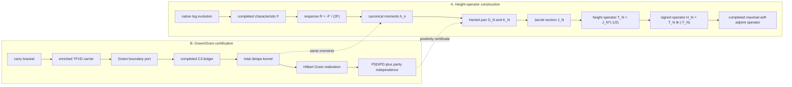

# Carry Self-Adjoint Operator

Lean 4 formalization of a native-carry construction of finite and completed
signed-height operators. The operator is derived from the completed native
characteristic and its logarithmic moments. It does **not** accept a zero
table, target heights, a fitted Jacobi matrix, or a scanned spectral parameter
as input.

## Two Routes, One Construction

This repository contains two related routes. They meet at the moment kernel,
but they are not the same proof.

| Route | Purpose | Output |
|---|---|---|
| **Height-operator route** | Derive the Jacobi and signed-height operators from the native characteristic and explicit certificates | Symmetric finite operators and maximal self-adjoint completed constructions |
| **Green/Gram route** | Relate the same moments to a positive Hilbert kernel | PSD/PD implications and the independence data consumed by the operator route |



## The Exact Meeting Point

Let

$$
F(z)=\texttt{completedNativeOperatorCharacteristic}(z),
\qquad
R(z)=\frac{-F'(z)}{2F(z)}.
$$

The completed C3 ledger keeps its channels separate until the final readout:

$$
\mathcal L_M=
(\text{radial},\text{provenance},\text{off-diagonal},\text{residual},
\text{tail},\xi,\text{chart}).
$$

After that final readout, and only then, the nonzero chart,
characteristic, and separation factors are normalized. On the real height
axis the resulting total kernel is

$$
\mathcal K_M(x,z)
=\operatorname{dslope}R(x,z)
=
\begin{cases}
\dfrac{R(z)-R(x)}{z-x}, & x\ne z,\\[6pt]
R'(x), & x=z.
\end{cases}
$$

Whenever `F(x)` and `F(z)` are nonzero, the identity is exact at every
cutoff:

$$
\mathcal K_M(x,z)=\mathcal K_N(x,z)
\qquad\text{for all }M,N.
$$

Its mixed forward differences converge to the canonical polarized moments in
all four even/odd blocks. This is formalized in
[`CompletedC3FinalReadoutKernelBridge.lean`](CarrySelfAdjointOperator/CompletedC3FinalReadoutKernelBridge.lean):

- `canonicalCompletedC3AllCutoffOffDiagonalKernelReadout_eq`;
- `canonicalCompletedC3AllCutoffRealKernelReadout_eq_dslope`;
- `canonicalCompletedC3AllCutoffRealKernelReadout_cutoff_independent`;
- `canonicalCompletedC3AllCutoffRealAxisKernelForwardDifference_tendsto_moment`;
- `canonicalCompletedC3AllCutoffRealAxisKernelParityForwardDifference_tendsto`.

> **Logical guardrail:** the theorem above proves
> `completed ledger -> dslope kernel -> moments`. It does not silently replace
> the scalar readout by a positive inner product. Positivity uses the separate
> identity `K(x,z) = <Phi(x), Phi(z)>` with an actual Hilbert-valued state
> `Phi`.

That distinction prevents the scalar Green/Wronskian sewing from being
confused with the Gram-positivity certificate used to construct the Jacobi
operator.

| Formal statement | Lean status |
|---|---|
| Native characteristic determines one real moment sequence | Proved by recurrence and uniqueness |
| Completed C3 final readout gives the total `dslope` kernel | Proved, cutoff-independent |
| Mixed kernel differences give all four moment blocks | Proved by an all-order limit |
| Hilbert realization of that kernel implies Hankel PSD | Proved as a representation theorem |
| Prefix independence upgrades PSD to PD | Proved for the even and odd families |
| Scalar readout alone is a positive Gram | Deliberately not asserted |

At the Lean type level, Route A consumes explicit arguments such as
`IsShiftedMomentGramRepresentation`, `Matrix.PosDef`, and
`LinearIndependent`. Route B is responsible for constructing or transporting
those certificates. This boundary separates the derivation of the height
operator from the proof that its canonical moment matrices are positive.

## Route A: Height Operator

### 1. Native characteristic

The starting operator is the maximal self-adjoint logarithmic generator,
with its exact basis law formalized by
`nativeLogGenerator_isSelfAdjoint` and
`nativeLogGenerator_basisVector_log` in
[`NativeLogEvolution.lean`](CarrySelfAdjointOperator/NativeLogEvolution.lean).

The exact head-plus-tail camera characteristic is cutoff-independent. After
removing the camera chart and applying the completion factor, the common
scalar is

$$
F(z)=\texttt{nativeXiCompletionFactor}(z)\,
     \texttt{nativeHeightScalar}(z).
$$

The camera-independent definition and its cross-multiplied camera bridge are
in
[`CompletedOperatorCharacteristic.lean`](CarrySelfAdjointOperator/CompletedOperatorCharacteristic.lean).
No division by a camera factor is used in that bridge.

### 2. Canonical logarithmic moments

Write the even characteristic in its real Taylor coordinate as

$$
\Phi(u)=\sum_{n\ge 0}a_n u^n,
\qquad a_0\ne0.
$$

The moments are defined recursively by the division-free logarithmic
derivative identity

$$
a_0h_n+
\sum_{k=0}^{n-1}h_k a_{n-k}
=-(n+1)a_{n+1}.
$$

This produces a unique real sequence

$$
h_n=\texttt{canonicalCompletedNativeLogDerivativeMoment}(n).
$$

The definition, recurrence, existence, and uniqueness are in
[`CompletedNativeRealWeylMoments.lean`](CarrySelfAdjointOperator/CompletedNativeRealWeylMoments.lean),
notably:

- `canonicalCompletedNativeLogDerivativeMoment_isMomentSequence`;
- `completedNativeLogDerivativeMoment_eq_canonical`.

### 3. Hankel pair and canonical whitening

For each finite order `N`, the two moment sections are

$$
G_N(i,j)=h_{i+j},
\qquad
K_N(i,j)=h_{i+j+1}.
$$

The normalized LDL decomposition of `G_N` fixes the whitening factor
canonically:

$$
B_NG_NB_N^{\mathsf T}=I.
$$

The Jacobi section is then

$$
J_N=B_NK_NB_N^{\mathsf T}.
$$

The definitions and exact whitening laws are in
[`CanonicalLDLWhitening.lean`](CarrySelfAdjointOperator/CanonicalLDLWhitening.lean)
and
[`CanonicalFiniteHeight.lean`](CarrySelfAdjointOperator/CanonicalFiniteHeight.lean).
The positivity and independence arguments are explicit parameters here; no
fitted matrix is hidden in the definition.

### 4. Positive and signed heights

Functional calculus gives

$$
T_N=J_N^{-1/2},
\qquad
H_N=T_N\oplus(-T_N).
$$

Lean proves exact symmetry and the finite spectral readout:

- `canonicalFiniteHeightOperator_isSymm`;
- `canonicalFiniteHeightOperator_charpoly`;
- `canonicalSignedFiniteHeightOperator_isSymm`;
- `canonicalSignedFiniteHeightOperator_charpoly`;
- `signedSectorReflection_conj_canonicalSignedFiniteHeightOperator`.

See
[`CanonicalFiniteHeight.lean`](CarrySelfAdjointOperator/CanonicalFiniteHeight.lean)
and
[`SignedFiniteHeightOperator.lean`](CarrySelfAdjointOperator/SignedFiniteHeightOperator.lean).

### 5. Completed operator

The compatible Green-jet tower is promoted to closed even and odd Hilbert
sectors. The closed energy factor produces

$$
J=B^*B,
$$

and the reciprocal signed block realizes the completed height operator. The
reduced construction does not require the separate zero-mass/head-tail
closure field.

The principal self-adjointness statements are:

- `closedGreenJetReducedReciprocalSignedHeightOperator_adjoint_eq`;
- `canonicalCompletedGreenJetReducedReciprocalSignedHeightOperator_adjoint_eq`;
- `heightOperator_adjoint_eq`;
- `reducedHeightOperator_adjoint_eq`.

They are formalized in
[`GreenJetReciprocalSignedHeightOperator.lean`](CarrySelfAdjointOperator/GreenJetReciprocalSignedHeightOperator.lean)
and
[`CompletedNativeGreenWeylHeight.lean`](CarrySelfAdjointOperator/CompletedNativeGreenWeylHeight.lean).
The corresponding certificate types expose their moment, Gram, parity, and
closure inputs rather than hiding them as global assumptions.

The complexified reduced operator has real point eigenvalues by
`complexifiedReducedHeightOperator_eigenvalue_im_eq_zero` in
[`CompletedNativeJacobiWeylContinuation.lean`](CarrySelfAdjointOperator/CompletedNativeJacobiWeylContinuation.lean).

## Route B: Green and Gram Positivity

### 1. Geometry to TFVD and Green

The geometric route is retained before scalarization:

$$
\text{center/legs}
\longrightarrow\text{causal bracket}
\longrightarrow\text{enriched TFVD state}
\longrightarrow\text{Green boundary port}.
$$

The completed source stores value, log-jet, exact tails, provenance, and the
Green port in one state. The four completed scalar traces are identified with

$$
(F(z),-F'(z),F(w),-F'(w)),
$$

while the Green side remains in its direct, reflected, and quarter-turned
Naimark coordinates. See:

- [`CompletedC3FourTraceSymplecticBridge.lean`](CarrySelfAdjointOperator/CompletedC3FourTraceSymplecticBridge.lean);
- [`CompletedC3EnrichedSymplecticNoLeakBridge.lean`](CarrySelfAdjointOperator/CompletedC3EnrichedSymplecticNoLeakBridge.lean);
- [`CompletedC3BracketTfvdGreenFactorization.lean`](CarrySelfAdjointOperator/CompletedC3BracketTfvdGreenFactorization.lean).

The final readout reconstructs the completed Wronskian of `(F,-F')` exactly,
but no structural channel is declared zero in that identity.

### 2. Scalar kernel to finite moments

The new completed bridge proves

$$
\text{C3 final readout}
\longrightarrow \operatorname{dslope}R
\longrightarrow \bigl(h_{i+j}\bigr)_{i,j}
\quad\text{and}\quad
\bigl(h_{i+j+1}\bigr)_{i,j}.
$$

This part is cutoff-independent and does not use a list of spectral heights.

### 3. Gram certification

If the same real-axis kernel is realized by a Hilbert state,

$$
\operatorname{dslope}R(x,z)
=\langle\Phi(x),\Phi(z)\rangle,
$$

then its finite forward differences are honest Gram matrices. Entrywise
limits therefore give

$$
G_N\succeq0,
\qquad
K_N\succeq0.
$$

Linear independence of the even and odd feature prefixes upgrades these to
strict positivity. The relevant interfaces and implications are in:

- [`CompletedGreenForwardDifferenceGramBridge.lean`](CarrySelfAdjointOperator/CompletedGreenForwardDifferenceGramBridge.lean);
- [`GreenKernelCoefficientClosure.lean`](CarrySelfAdjointOperator/GreenKernelCoefficientClosure.lean);
- [`BR2IncidenceStrictPositivity.lean`](CarrySelfAdjointOperator/BR2IncidenceStrictPositivity.lean);
- [`CurrentInfiniteHeightStatus.lean`](CarrySelfAdjointOperator/CurrentInfiniteHeightStatus.lean).

In particular, `BR2BracketIncidenceJetTransport` is all-order: its even and
odd identities are indexed by every `n : Nat`, and injectivity transports the
global bracket-incidence independence to the complete Green-jet families.

## What Is Not Being Identified

The following objects are deliberately distinct in the formalization:

| Object | Type of information |
|---|---|
| Completed C3 ledger | Vector state with separated geometric and boundary channels |
| Final Green/Wronskian readout | Complex scalar obtained only after channel retention |
| `dslope` kernel | Total scalar two-point kernel, including the removable diagonal |
| Hilbert Gram kernel | Positive inner-product realization of that scalar kernel |
| Jacobi/height operator | Operator constructed from the certified moment pair |

Consequently:

$$
\boxed{\text{scalar equality}\ne\text{positivity proof}}
$$

and

$$
\boxed{\text{self-adjointness}\ne
\text{an unproved identification of every scalar zero with point spectrum}}.
$$

Every theorem that crosses one of these boundaries names the corresponding
certificate or representation explicitly.

## Repository Map

| Layer | Main modules |
|---|---|
| Native geometry and recurrence | `NativeCausalBracket`, `NativeAllBasesCameraAtlas`, `NativeCameraResidueReflection` |
| Completed characteristic | `CompletedNativeCharacteristic`, `CompletedOperatorCharacteristic`, `CompletedProductJet` |
| Real moments | `CompletedNativeRealWeylMoments`, `CompletedNativeTfvdWronskianMoments` |
| Finite Jacobi and heights | `CanonicalLDLWhitening`, `CanonicalFiniteHeight`, `SignedFiniteHeightOperator` |
| Completed Green carrier | `CompletedNativeC3LedgerState`, `CompletedC3AllCutoffHilbertState`, `CompletedC3EnrichedSymplecticNoLeakBridge` |
| Scalar kernel bridge | `CompletedGreenRealKernelClosure`, `CompletedGreenForwardDifferenceLimit`, `CompletedC3FinalReadoutKernelBridge` |
| Gram positivity | `CompletedGreenForwardDifferenceGramBridge`, `BR2IncidenceStrictPositivity`, `GreenKernelCoefficientClosure` |
| Infinite operator | `GreenJetEnergyFactor`, `GreenJetMaximalAdjointSquare`, `GreenJetReciprocalSignedHeightOperator` |
| Weyl/resolvent readout | `CompletedNativeJacobiCyclicReadout`, `CompletedNativeJacobiWeylContinuation`, `CompletedNativeComplexGraphResolvent` |

## Supporting Notes

- [Causal bracket reconstruction and uniqueness](docs/causal-bracket-state-uniqueness.md)
- [Center/leg residue reflection](docs/bracket-residue-reflection-orbit.md)
- [Finite Green-jet/signed-height intertwiner](docs/canonical-green-jet-signed-height-intertwiner.md)
- [Completed Green-jet Hilbert space](docs/green-jet-signed-height-hilbert-space.md)
- [Global parity reflection](docs/green-jet-parity-reflection.md)
- [Energy-factor closability](docs/green-jet-energy-factor-closability.md)
- [Global reciprocal signed-height operator](docs/global-reciprocal-signed-height-operator.md)
- [Completed C3 Green/Wronskian frontier](docs/completed-c3-green-wronskian-frontier.md)

## Verification

```bash
lake build
bash scripts/audit.sh
```

The audit rejects `sorry`, checks the theorem surface, and reports the axioms
used by the exported results. GitHub Actions builds the exact dependency
checkout recorded by the repository.
