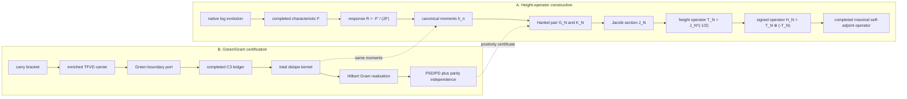
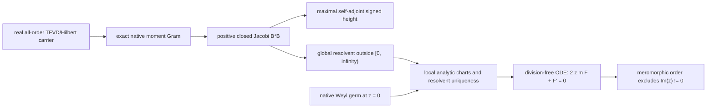

**Consolidação de 2/10/2026:** a cadeia C2/Green/Parseval e os módulos finitos
recuperados estão descritos no [índice de recuperação](docs/RECOVERY_2026-10-02.md),
com hashes, limites matemáticos e comandos de auditoria.

# Carry Self-Adjoint Operator

Lean 4 formalization of a native-carry construction of finite and completed
signed-height operators. The operator is derived from the completed native
characteristic and its logarithmic moments. It does **not** accept a zero
table, target heights, a fitted Jacobi matrix, or a scanned spectral parameter
as input.

## Canonical source provenance — current kernel-checked route

This section records the verified source route on published `main`:

```text
carry / C2 center-core
→ prime-depth ledger
→ log n
→ native log slope / logJet
→ completed TFVD head + exact value/logJet tails
→ completed prime-depth normalized response
→ geometric moment recurrence
→ canonical moment sequence by uniqueness
→ future geometric Gram/Stieltjes/Jacobi/height identification
```

The source-first declarations are:

- `primeDepthLogLedger_eq_log`;
- `finitePrimeDepthGeneratedLogSlopePrefixState_eq_completedTfvdLogJetPrefix`;
- `primeDepthGeometricMoment`;
- `primeDepthGeometricMoment_isLogDerivativeMomentSequence`;
- `primeDepthGeometricMoment_eq_canonical`;
- `primeDepthGeometricMoment_eq_bracketTfvdReadoutTaylor`.

The geometric sequence is defined from the odd coefficients of the completed
prime-depth response. Its recurrence is proved before identification with the
canonical sequence by `IsLogDerivativeMomentSequence.unique`.
The historical name “C2 hybrid operator” refers here to a chain of components;
no equivalence with one declaration bearing that name is asserted.

The scalar source provenance is closed. The new
`PrimeDepthNormalizedResponseVectorJet` module also closes an all-order
**structural trace vector lift with a fixed continuous linear readout**:
`primeDepthNormalizedResponseVectorJet_readout`. It retains the existing
head, exact tail, archimedean completion and chart-correction sectors, and
normalizes their vector jets by a coherent finite triangular convolution.
No moment value defines the vectors or the transform.

This carrier is a finite Hilbert family of existing completed Wronskian
trace carriers. It is a vector projection after completed TFVD reconstruction,
not a claimed lossless Hilbert embedding of every original TFVD coordinate.
No moment Gram identification, clock intertwining, Krylov independence or
strict positivity follows from the readout theorem. Equality of those
readouts alone does not determine an inner product kernel. See the
[vector-lift report](docs/PRIME_DEPTH_NORMALIZED_RESPONSE_VECTOR_JET_LIFT.md).


A separate kernel route is now closed in
`CompletedNativeProjectiveChiralForwardDifference`:

```text
prime-depth geometric moments
+ projective/chiral signed geometric form
→ polarized dslope kernel on regular shifted radial samples
→ all-order finite-difference pairing limit
```

`projectiveChiralDifferenceJet_pairing_tendsto_primeDepthCoefficient`
identifies every signed pairing limit with the corresponding polarized
prime-depth coefficient. The four parity blocks give `g_(i+j)`,
`g_(i+j+1)`, zero and zero. Literal derivative-order canaries `(0,0)`,
`(0,1)`, `(1,1)` have limits `g0`, zero, `g1`; `(2,2)` gives `g2`.

The projective/chiral form realizes the moment kernel **as a signed geometric
pairing limit**. Positivity remains a separate contractivity/Pick gate:
`CanonicalCompletedNativeRadialChiralMultiplierEventuallyContractive`.
`PASS_PAIRING` is not `PASS_POSITIVITY`. No vector convergence, positive
Hilbert Gram, or transport identifying these radial difference vectors with
the earlier prime-depth trace jets is asserted. See the
[signed-pairing report](docs/PROJECTIVE_CHIRAL_FORWARD_DIFFERENCE_MOMENT_PAIRING.md).


The accumulated-return frontier is now expressed directly in complete source
vectors by `CompletedNativeChiralReturnSourceTrace`. With `V` the Cauchy
synthesis of the completed value trace and `C` that of its companion `-F'`,
`ChiralReturn.storage_one_eventually_eq_source_cross` proves, for every finite
family and every coefficient vector,
`Re storage = 4 * Im inner V C`. The same vectors reconstruct incidence as
`C + i V` and return as `C - i V`; their total-energy identity controls the
sum of the two energies, not their dominance.

Status: `PARTIAL_SOURCE_FIRST_CHIRAL_RETURN_STORAGE_POSITIVITY`.
The single open sign is eventual nonnegativity of this complete-source mixed
pairing for **all** coefficients. No nonnegative complementary channel,
all-order contractivity or Pick/Herglotz/dslope PSD is claimed. Existing
one/two-point sign results are diagnostics, not a uniform source proof.
Strictness remains separate. See the
[source-storage audit](docs/CHIRAL_RETURN_SOURCE_STORAGE_AUDIT.md).

The mixed orientation now has an exact crosswalk to the **corrected** C3
Green/TFVD ledger, retaining every ordered Cauchy cross term. The new
`ChiralReturn.source_cross_eventually_eq_corrected_green_ledger` is uniform
in cutoff, coefficients and internal radius on each finite radial family.
Its Green-port term is accompanied by all five existing provenance,
off-diagonal, readout, tail and archimedean/chart corrections. This is a
signed identity, not a positivity proof or an identification with the
all-bases `GreenFrame.Concrete` stencil defect. The missing source-to-stencil
morphism is recorded in the
[Green crosswalk audit](docs/COMPLETED_SOURCE_GREEN_DEFECT_CROSSWALK_AUDIT.md).

The product-rule completion is now separated **inside the unchanged Cauchy
source vectors**, by `CompletedNativeChiralReturnCompletionSplit`:
`sourceCompanion = nativeDressedCompanion + completionCompanion`.
The second vector is precisely the existing `-A' * Z` channel, with the
original chiral denominator. Its skew pairing with the full value vector is
exactly the archimedean Green correction summed over every ordered sample
pair. The weighted native Green term is transported in the same carrier.
Both channels have the same tail-completed TFVD provenance at every cutoff.

The center canary retains the exact factor-jet cancellation; the two-sample
canary retains both off-diagonal terms. Storage equals the sum of these two
signed orientations eventually, uniformly in all coefficient vectors and
internal radii on each finite sample family. This is a **vector completion
split and signed Green-form transport**, not a positive Hilbert norm,
contractivity proof or division-free Hilbert witness. The independent metric
sewing gate remains open. See the
[completion vector-split report](docs/CHIRAL_RETURN_COMPLETION_VECTOR_SPLIT.md).

The complete-source balance is now polarized in
`CompletedNativeChiralReturnPolarizedGreen`, with **independent coefficient
families** and internal radii. `polarizedSourceBalance_eq_corrected_green_ledger`
keeps every ordered cross term and all existing completion/boundary corrections.
Its Hermitian diagonal is exactly the unchanged real storage; the conservative
total-energy sum also polarizes. A common complex isometric repackaging
preserves the signed balance exactly.

Status: `PASS_COMPLETED_SOURCE_POLARIZED_GREEN_BALANCE`;
`PARTIAL_POLARIZED_GREEN_PYTHAGOREAN_SEWING`. The geometric Pythagorean gate is
still to identify an actual complementary source channel D satisfying
`inner incidence incidence - inner return return = inner D D` for independent
coefficient families. No such positive channel is constructed here.
Reconstruction or Parseval conservation alone does not identify it; no
positivity, contractivity or strictness follows yet. See the
[polarized Green / Pythagorean audit](docs/POLARIZED_GREEN_PYTHAGOREAN_AUDIT.md).

The oriented completed-source audit now localizes the next Hilbert sewing
gate. Bounded Green synthesis preserves **both weighted vertical boundary
coordinates** and the full TFVD reconstruction. However, the current raw
oriented carrier uses a maximum product norm that fails the parallelogram
identity. Recovering its two channels, applying existing Parseval analysis,
and complexifying the retained residual reproduces exactly the older
concrete positive candidate already excluded by its normalized-kernel defect;
it supplies no new division-free witness. Exact completion tails remain
separate from a homogeneous finite prefix: the zero prefix cannot linearly
read out the nonzero completed central value. The complex real-axis wrapper
also retains only the real parameter. These are local presentation/scope
obstructions, not a no-go for a larger complete geometric realization.

Status: `PARTIAL_ORIENTED_COMPLETED_SOURCE_DIVISION_FREE_GREEN_REPRESENTATION`.
The open construction is a continuous, source-derived complex Hilbert state
satisfying the **full division-free Green identity**. The projective-valve
roundtrip preserves boundary and curvature data but does not by itself
provide this metric identity. No new positivity, contractivity or strictness
is claimed. See the [oriented source audit](docs/ORIENTED_COMPLETED_SOURCE_DIVISION_FREE_GREEN_AUDIT.md).

BR2 is not used as the source of the canonical moment sequence. It remains a
possible downstream independence/strictness mechanism only if a proved
transport to the final vector family is supplied. Earlier BR2, carrier and
operator routes below are historical, downstream or alternative interfaces;
they do not replace the source-first provenance above.

## Canonical Closed Handoff: Native/Genuine Certificate to Self-Adjoint Height

The canonical closed interface between native moment geometry and the existing
all-order operator machinery is
`CompletedNativeRealHPCarrierCertificate jet`, defined in
[`CompletedNativeHPGateAudit.lean`](CarrySelfAdjointOperator/CompletedNativeHPGateAudit.lean).
It has exactly three fields:

- `momentKernel`;
- `evenIndependent`;
- `oddIndependent`.

| Stage | Canonical declaration |
|---|---|
| Native scalar = Genuine | `nativeScalar_eq_genuineContinuation_unconditional` |
| HP carrier interface | `CompletedNativeRealHPCarrierCertificate` |
| Three obligations | `momentKernel`, `evenIndependent`, `oddIndependent` |
| Certificate → strict Hankel pair | `CompletedNativeRealHPCarrierCertificate.hankelPair_posDef` |
| Certificate → Stieltjes | `canonicalCompletedNativeStieltjesPositivity_of_certificate` |
| Camera moments = canonical moments | `nativeGeometry_cameraMoments_eq_canonical` |
| Camera Hankel pair = canonical pair | `nativeGeometry_cameraHankelPair_eq_canonical` |
| Camera Jacobi = canonical Jacobi | `nativeGeometry_cameraJacobiSection_eq_canonical` |
| Same finite height from Green carrier | `nativeGeometryFiniteHeightOperator_eq_of_greenMomentKernel` |
| Native/Genuine all-order adapter | `nativeCameraGenuineAllOrderInstantiation_of_certificate` |
| Positive completed Jacobi package | `CompletedNativeRealHPCarrierCertificate.completedJacobiEnergySelfAdjointData` |
| Completed signed-height package | `CompletedNativeRealHPCarrierCertificate.toReducedMaximalSelfAdjointHeightData` |

> [!IMPORTANT]
> `CompletedNativeRealHPCarrierCertificate` is the closed interface between
> the geometric/Gram side and the already-built all-order operator machinery.
> It has exactly three fields: `momentKernel`, `evenIndependent`, and
> `oddIndependent`.
>
> Once such a certificate is supplied, no additional J/H quotient,
> post-T0 Hilbert scale, Gamma/Herglotz/Pick construction, or new positivity
> hypothesis is required to instantiate the native-camera/Genuine
> Hankel–Jacobi–height chain.

There is no fourth universal HP-certificate obligation. The operator is not
fitted from target heights or a zero table: the certificate authenticates the
native moment geometry, while the downstream Hankel/Jacobi/self-adjoint
machinery is already constructed.

The canonical capstone is
[`nativeCameraGenuineAllOrderInstantiation_of_certificate`](CarrySelfAdjointOperator/NativeCameraGenuineAllOrderInstantiation.lean).
It only changes the source instantiation; it does not rebuild the all-order
derivatives, triangular convolution, parity split, finite-prefix arguments,
limit passage, Hankel/Jacobi construction, Hilbert completion, or
self-adjoint operator.

```text
nativeScalar = genuineContinuation
        ↓
canonical native log-derivative moments
        ↓
CompletedNativeRealHPCarrierCertificate
   ├─ momentKernel
   ├─ evenIndependent
   └─ oddIndependent
        ↓
canonicalCompletedNativeStieltjesPositivity_of_certificate
        ↓
strict Hankel pair positivity, for every N
        ↓
canonical Jacobi tower → finite height J_N^(-1/2)
        ↓
completed maximal self-adjoint signed-height operator
```

> [!NOTE]
> The historical and exploratory routes documented below — including Gamma,
> Herglotz/Pick, J/H, post-T0 scales, raw seeded-clock atlases, and alternative
> sewing constructions — are auxiliary provenance, representation, or
> certificate-construction routes. They are not additional prerequisites of
> `nativeCameraGenuineAllOrderInstantiation_of_certificate` once a
> `CompletedNativeRealHPCarrierCertificate` is supplied.

## Two Routes, One Construction

This repository contains two related routes. They meet at the moment kernel,
but they are not the same proof.

| Route | Purpose | Output |
|---|---|---|
| **Height-operator route** | Derive the Jacobi and signed-height operators from the native characteristic and explicit certificates | Symmetric finite operators and maximal self-adjoint completed constructions |
| **Green/Gram route** | Relate the same moments to a positive Hilbert kernel | PSD/PD implications and the independence data consumed by the operator route |



## The Exact Meeting Point

Let

$$
F(z)=\texttt{completedNativeOperatorCharacteristic}(z),
\qquad
R(z)=\frac{-F'(z)}{2F(z)}.
$$

The completed C3 ledger keeps its channels separate until the final readout:

$$
\mathcal L_M=
(\text{radial},\text{provenance},\text{off-diagonal},\text{residual},
\text{tail},\xi,\text{chart}).
$$

After that final readout, and only then, the nonzero chart,
characteristic, and separation factors are normalized. On the real height
axis the resulting total kernel is

$$
\mathcal K_M(x,z)
=\operatorname{dslope}R(x,z)
=
\begin{cases}
\dfrac{R(z)-R(x)}{z-x}, & x\ne z,\\[6pt]
R'(x), & x=z.
\end{cases}
$$

Whenever `F(x)` and `F(z)` are nonzero, the identity is exact at every
cutoff:

$$
\mathcal K_M(x,z)=\mathcal K_N(x,z)
\qquad\text{for all }M,N.
$$

Its mixed forward differences converge to the canonical polarized moments in
all four even/odd blocks. This is formalized in
[`CompletedC3FinalReadoutKernelBridge.lean`](CarrySelfAdjointOperator/CompletedC3FinalReadoutKernelBridge.lean):

- `canonicalCompletedC3AllCutoffOffDiagonalKernelReadout_eq`;
- `canonicalCompletedC3AllCutoffRealKernelReadout_eq_dslope`;
- `canonicalCompletedC3AllCutoffRealKernelReadout_cutoff_independent`;
- `canonicalCompletedC3AllCutoffRealAxisKernelForwardDifference_tendsto_moment`;
- `canonicalCompletedC3AllCutoffRealAxisKernelParityForwardDifference_tendsto`.

> **Logical guardrail:** the theorem above proves
> `completed ledger -> dslope kernel -> moments`. It does not silently replace
> the scalar readout by a positive inner product. Positivity uses the separate
> identity `K(x,z) = <Phi(x), Phi(z)>` with an actual Hilbert-valued state
> `Phi`.

That distinction prevents the scalar Green/Wronskian sewing from being
confused with the Gram-positivity certificate used to construct the Jacobi
operator.

| Formal statement | Lean status |
|---|---|
| Native characteristic determines one real moment sequence | Proved by recurrence and uniqueness |
| Completed C3 final readout gives the total `dslope` kernel | Proved, cutoff-independent |
| Mixed kernel differences give all four moment blocks | Proved by an all-order limit |
| Hilbert realization of that kernel implies Hankel PSD | Proved as a representation theorem |
| Prefix independence upgrades PSD to PD | Proved for the even and odd families |
| Scalar readout alone is a positive Gram | Deliberately not asserted |

At the Lean type level, Route A consumes explicit arguments such as
`IsShiftedMomentGramRepresentation`, `Matrix.PosDef`, and
`LinearIndependent`. Route B is responsible for constructing or transporting
those certificates. This boundary separates the derivation of the height
operator from the proof that its canonical moment matrices are positive.

## Route A: Height Operator

### 1. Native characteristic

The starting operator is the maximal self-adjoint logarithmic generator,
with its exact basis law formalized by
`nativeLogGenerator_isSelfAdjoint` and
`nativeLogGenerator_basisVector_log` in
[`NativeLogEvolution.lean`](CarrySelfAdjointOperator/NativeLogEvolution.lean).

The exact head-plus-tail camera characteristic is cutoff-independent. After
removing the camera chart and applying the completion factor, the common
scalar is

$$
F(z)=\texttt{nativeXiCompletionFactor}(z)\,
     \texttt{nativeHeightScalar}(z).
$$

The camera-independent definition and its cross-multiplied camera bridge are
in
[`CompletedOperatorCharacteristic.lean`](CarrySelfAdjointOperator/CompletedOperatorCharacteristic.lean).
No division by a camera factor is used in that bridge.

### 2. Canonical logarithmic moments

Write the even characteristic in its real Taylor coordinate as

$$
\Phi(u)=\sum_{n\ge 0}a_n u^n,
\qquad a_0\ne0.
$$

The moments are defined recursively by the division-free logarithmic
derivative identity

$$
a_0h_n+
\sum_{k=0}^{n-1}h_k a_{n-k}
=-(n+1)a_{n+1}.
$$

This produces a unique real sequence

$$
h_n=\texttt{canonicalCompletedNativeLogDerivativeMoment}(n).
$$

The definition, recurrence, existence, and uniqueness are in
[`CompletedNativeRealWeylMoments.lean`](CarrySelfAdjointOperator/CompletedNativeRealWeylMoments.lean),
notably:

- `canonicalCompletedNativeLogDerivativeMoment_isMomentSequence`;
- `completedNativeLogDerivativeMoment_eq_canonical`.

### 3. Hankel pair and canonical whitening

For each finite order `N`, the two moment sections are

$$
G_N(i,j)=h_{i+j},
\qquad
K_N(i,j)=h_{i+j+1}.
$$

The normalized LDL decomposition of `G_N` fixes the whitening factor
canonically:

$$
B_NG_NB_N^{\mathsf T}=I.
$$

The Jacobi section is then

$$
J_N=B_NK_NB_N^{\mathsf T}.
$$

The definitions and exact whitening laws are in
[`CanonicalLDLWhitening.lean`](CarrySelfAdjointOperator/CanonicalLDLWhitening.lean)
and
[`CanonicalFiniteHeight.lean`](CarrySelfAdjointOperator/CanonicalFiniteHeight.lean).
The positivity and independence arguments are explicit parameters here; no
fitted matrix is hidden in the definition.

### 4. Positive and signed heights

Functional calculus gives

$$
T_N=J_N^{-1/2},
\qquad
H_N=T_N\oplus(-T_N).
$$

Lean proves exact symmetry and the finite spectral readout:

- `canonicalFiniteHeightOperator_isSymm`;
- `canonicalFiniteHeightOperator_charpoly`;
- `canonicalSignedFiniteHeightOperator_isSymm`;
- `canonicalSignedFiniteHeightOperator_charpoly`;
- `signedSectorReflection_conj_canonicalSignedFiniteHeightOperator`.

See
[`CanonicalFiniteHeight.lean`](CarrySelfAdjointOperator/CanonicalFiniteHeight.lean)
and
[`SignedFiniteHeightOperator.lean`](CarrySelfAdjointOperator/SignedFiniteHeightOperator.lean).

### 5. Completed operator

The compatible Green-jet tower is promoted to closed even and odd Hilbert
sectors. The closed energy factor produces

$$
J=B^*B,
$$

and the reciprocal signed block realizes the completed height operator. The
reduced construction does not require the separate zero-mass/head-tail
closure field.

The principal self-adjointness statements are:

- `closedGreenJetReducedReciprocalSignedHeightOperator_adjoint_eq`;
- `canonicalCompletedGreenJetReducedReciprocalSignedHeightOperator_adjoint_eq`;
- `heightOperator_adjoint_eq`;
- `reducedHeightOperator_adjoint_eq`.

They are formalized in
[`GreenJetReciprocalSignedHeightOperator.lean`](CarrySelfAdjointOperator/GreenJetReciprocalSignedHeightOperator.lean)
and
[`CompletedNativeGreenWeylHeight.lean`](CarrySelfAdjointOperator/CompletedNativeGreenWeylHeight.lean).
The corresponding certificate types expose their moment, Gram, parity, and
closure inputs rather than hiding them as global assumptions.

The complexified reduced operator has real point eigenvalues by
`complexifiedReducedHeightOperator_eigenvalue_im_eq_zero` in
[`CompletedNativeJacobiWeylContinuation.lean`](CarrySelfAdjointOperator/CompletedNativeJacobiWeylContinuation.lean).

## Route B: Green and Gram Positivity

### 1. Geometry to TFVD and Green

The geometric route is retained before scalarization:

$$
\text{center/legs}
\longrightarrow\text{causal bracket}
\longrightarrow\text{enriched TFVD state}
\longrightarrow\text{Green boundary port}.
$$

The completed source stores value, log-jet, exact tails, provenance, and the
Green port in one state. The four completed scalar traces are identified with

$$
(F(z),-F'(z),F(w),-F'(w)),
$$

while the Green side remains in its direct, reflected, and quarter-turned
Naimark coordinates. See:

- [`CompletedC3FourTraceSymplecticBridge.lean`](CarrySelfAdjointOperator/CompletedC3FourTraceSymplecticBridge.lean);
- [`CompletedC3EnrichedSymplecticNoLeakBridge.lean`](CarrySelfAdjointOperator/CompletedC3EnrichedSymplecticNoLeakBridge.lean);
- [`CompletedC3BracketTfvdGreenFactorization.lean`](CarrySelfAdjointOperator/CompletedC3BracketTfvdGreenFactorization.lean).

The final readout reconstructs the completed Wronskian of `(F,-F')` exactly,
but no structural channel is declared zero in that identity.

### 2. Scalar kernel to finite moments

The new completed bridge proves

$$
\text{C3 final readout}
\longrightarrow \operatorname{dslope}R
\longrightarrow \bigl(h_{i+j}\bigr)_{i,j}
\quad\text{and}\quad
\bigl(h_{i+j+1}\bigr)_{i,j}.
$$

This part is cutoff-independent and does not use a list of spectral heights.

### 3. Gram certification

If the same real-axis kernel is realized by a Hilbert state,

$$
\operatorname{dslope}R(x,z)
=\langle\Phi(x),\Phi(z)\rangle,
$$

then its finite forward differences are honest Gram matrices. Entrywise
limits therefore give

$$
G_N\succeq0,
\qquad
K_N\succeq0.
$$

Linear independence of the even and odd feature prefixes upgrades these to
strict positivity. The relevant interfaces and implications are in:

- [`CompletedGreenForwardDifferenceGramBridge.lean`](CarrySelfAdjointOperator/CompletedGreenForwardDifferenceGramBridge.lean);
- [`GreenKernelCoefficientClosure.lean`](CarrySelfAdjointOperator/GreenKernelCoefficientClosure.lean);
- [`BR2IncidenceStrictPositivity.lean`](CarrySelfAdjointOperator/BR2IncidenceStrictPositivity.lean);
- [`CurrentInfiniteHeightStatus.lean`](CarrySelfAdjointOperator/CurrentInfiniteHeightStatus.lean).

In particular, `BR2BracketIncidenceJetTransport` is all-order: its even and
odd identities are indexed by every `n : Nat`, and injectivity transports the
global bracket-incidence independence to the complete Green-jet families.

### 4. Fixed-parameter causal contraction audit

The proposed factorization of every causal source through one fixed positive
Wronskian readout is ruled out, rather than assumed. The positive trace has
real dimension `12`, while thirteen explicit completed C3 symplectic camera
states are real-linearly independent. Hence both the fixed-parameter kernel
compatibility and its defect-Gram contraction fail throughout the open upper
half-plane. This audit is proved in
[`CompletedC3CausalChiralKernelObstruction.lean`](CarrySelfAdjointOperator/CompletedC3CausalChiralKernelObstruction.lean)
using Dedekind independence of the underlying Dirichlet characters and the
existing global camera isometry; it uses no zero or spectral premise.

### 5. Coisometric ambient strict positivity

The obstruction is a failure of the fixed finite readout, not a loss of the
completed geometry.  On the canonical Naimark carrier, the complexified port
obeys the exact polarized identity

$$
\langle Uu,Uv\rangle=\langle u,v\rangle,
$$

as a direct consequence of the coisometric law $U^*U=I$.  Thus every finite
family of distinct positive real exponents produces a positive-definite
ambient response Gram.  In particular, the same thirteen states that cannot
factor through the fixed twelve-dimensional Wronskian trace have a strictly
positive Gram in the lossless ambient carrier.  This is formalized in
[`CompletedC3CoisometricAmbientStrictPositivity.lean`](CarrySelfAdjointOperator/CompletedC3CoisometricAmbientStrictPositivity.lean).

This theorem establishes strict positivity of the canonical ambient kernel.
It does not identify that kernel with the completed-native `dslope` moment
kernel; that identification remains a separate typed interface.

The first instance of that interface is now reduced exactly in
[`CompletedC3CoisometricAmbientMomentGate.lean`](CarrySelfAdjointOperator/CompletedC3CoisometricAmbientMomentGate.lean).
At the center, normalized ambient Gram equals the zeroth native moment if and
only if

$$
\frac{d^2}{dy^2}\left|F(iy)\right|^2\bigg|_{y=0}
=4\,\|\nabla_{C3}(1/2)\|^2.
$$

The equivalence is unconditional; the displayed curvature identity is not
asserted.  If supplied, it already forces strict positivity of the zeroth
moment because the completed C3 gradient is nonzero.

### 6. Projective/chiral carrier transformation

The raw ambient Gram is not renormalized to force the native moments. The
exact transformation is instead constructed in
[`CompletedNativeProjectiveChiralCarrier.lean`](CarrySelfAdjointOperator/CompletedNativeProjectiveChiralCarrier.lean).
For the canonical Cauchy feature $u_n$, it is

$$
u_n\longmapsto
A(z_n)\bigl(u_n,q(z_n)u_n\bigr),
$$

where $A$ is the normalized positive chiral amplitude and $q$ is the
completed Hermite--Biehler quotient. Keeping both coordinates separate, the
signed ambient form is

$$
\mathcal B((u_+,u_-),(v_+,v_-))
=\frac12\left(\langle u_+,v_+\rangle-\langle u_-,v_-\rangle\right).
$$

Lean proves entrywise on every regular radial finite section that

$$
\mathcal B\bigl(A_i(u_i,q_i u_i),A_j(u_j,q_j u_j)\bigr)
=K_{\mathrm{dslope}}(z_i,z_j).
$$

The same equality holds eventually on every finite section of the centered
all-order germ. The resulting matrix is positive semidefinite if and only
if the concrete chiral multiplier is contractive on that section. Thus the
projective transformation closes the kernel identification exactly, while
leaving contractivity visible as the positivity theorem rather than hiding
it in a normalization.

### 7. Central curvature and the first Pick coefficient

[`CompletedNativeCentralChiralQuotientCurvature.lean`](CarrySelfAdjointOperator/CompletedNativeCentralChiralQuotientCurvature.lean)
identifies the precise local bridge between the second-order characteristic
curvature and the first-order chiral/Pick variation.  For

$$
q(z)=\frac{-F'(z)-iF(z)}{-F'(z)+iF(z)},
$$

centered evenness gives $q(0)=-1$, while the zeroth completed-native moment
$h_0$ gives

$$
q'(0)=-4i h_0,
\qquad
\frac{d}{dy}q(iy)\bigg|_{y=0}=4h_0.
$$

Consequently the norm defect $D(y)=1-|q(iy)|^2$ satisfies
$D'(0)=8h_0$, and the diagonal Pick kernel has the removable value

$$
\lim_{y\to0,\,y\ne0}\frac{D(y)}{2y}=4h_0.
$$

The normalized positive chiral Gram tends to $1/4$ on the same line.  Lean
therefore proves the exact cancellation

$$
\boxed{
\left(\frac14\right)(4h_0)=h_0
}
$$

as a limit of the positive-channel Gram times the Pick kernel.  This is the
correct theorem relating the recurring quarter and four normalizations.  It
is the one-point, first-coefficient shadow of the next gate; it does not by
itself prove positive semidefiniteness of every finite Pick matrix, or the
equivalent all-order chiral-multiplier contractivity.
Lean also proves that strict positivity of $h_0$ is enough to make the first
radial multiplier section ($N=1$) eventually contractive.  Sections $N>1$
retain genuine off-diagonal Pick conditions and remain the all-order gate.

The four-corner results remain complementary rather than silently
identified with this curvature calculation.
[`CompletedC3FourCornerGreenCell.lean`](CarrySelfAdjointOperator/CompletedC3FourCornerGreenCell.lean)
proves both the exact Euler/logarithmic first boundary coefficient and the
first nonzero centered algebraic moment, which is quadratic and contains the
factor $1/4$.
[`CompletedC3FourCornerTaylorGram.lean`](CarrySelfAdjointOperator/CompletedC3FourCornerTaylorGram.lean)
then completes those cells to the all-order Taylor Gram.  No theorem currently
equates the Euler coefficient itself with the characteristic curvature; any
such crosswalk remains a separate identification obligation.

### 8. Cayley--Herglotz form of the remaining gate

[`CompletedNativeChiralCayleyHerglotz.lean`](CarrySelfAdjointOperator/CompletedNativeChiralCayleyHerglotz.lean)
rewrites the same quotient using the negative logarithmic derivative

$$
a(z)=-\frac{F'(z)}{F(z)},
\qquad
q(z)=\frac{a(z)-i}{a(z)+i}.
$$

At the center, Lean also proves

$$
a(0)=0,
\qquad
a'(0)=2h_0.
$$

This is the exact jet crosswalk behind the earlier observation: the first
local Herglotz/Pick ruler is supplied by the second-order curvature of $F$.

For the divided-difference kernel

$$
K_a(z,w)=\frac{a(w)-\overline{a(z)}}{w-\overline z}
$$

and the nonzero diagonal amplitude $c(z)=(a(z)+i)^{-1}$, Lean proves on
every regular pair the exact Cayley identity

$$
P_q(z,w)=2\,\overline{c(z)}\,K_a(z,w)\,c(w).
$$

Consequently every regular finite radial Pick matrix is positive
semidefinite if and only if the corresponding logarithmic-derivative
Herglotz matrix is positive semidefinite.  The equivalence is also proved
for the eventual all-section gates, giving

$$
\boxed{
\text{radial multiplier contractivity}
\iff
\text{eventual radial Herglotz-kernel positivity}.
}
$$

With the separately named finite-section nondegeneracy premise, this new
spelling feeds the existing Jacobi/HP theorem and implies zero confinement.
The factorization itself does not assert the Herglotz positivity: that
all-order positivity statement is now the explicit remaining obligation,
rather than an untracked normalization or curvature identity.

### 9. Signed-generator Gram realization of the Herglotz kernel

[`CompletedNativeSignedGeneratorHerglotzGram.lean`](CarrySelfAdjointOperator/CompletedNativeSignedGeneratorHerglotzGram.lean)
polarizes the direct signed-generator resolvent.  If

$$
x_z-zKx_z=e_0,
\qquad
x_w-wKx_w=e_0
$$

and $K$ is formally self-adjoint, Lean proves the abstract identity

$$
w\langle e_0,x_w\rangle-
\overline{z\langle e_0,x_z\rangle}
=
(w-\overline z)\langle x_z,x_w\rangle.
$$

For a completed-native real HP carrier certificate, the already-globalized
division-free ODE identifies

$$
a(z)=-\frac{F'(z)}{F(z)}
=2z\langle e_0,x_z\rangle
$$

throughout the regular upper height cone.  Hence the complete polarized
kernel, not just its diagonal, has the exact Gram realization

$$
\boxed{
K_a(z,w)=2\langle x_z,x_w\rangle.
}
$$

It follows in Lean that every finite restriction in the open upper cone is
positive semidefinite.  In particular, any real HP carrier certificate closes
the eventual radial Herglotz gate.  The resulting logical audit is exact:

$$
\boxed{
\text{strict Stieltjes positivity}
\iff
\text{radial Herglotz semidefiniteness}
\;\wedge\;
\text{finite-section nondegeneracy}.
}
$$

This does not manufacture the certificate for free.  Its moment-kernel field
already contains the all-order positive realization, so using it as the input
to prove Herglotz positivity is a representation theorem, not an independent
proof of the remaining gate.  The independent low-order result is sharper:
strict positivity of the central moment $h_0$ alone implies eventual
Herglotz positivity for the one-point radial section $N=1$.  This is precisely
the ruler/curvature shadow $a'(0)=2h_0$; sections $N>1$ retain genuinely
polarized off-diagonal obligations.  The earlier coisometric central gate is
now composed explicitly with this theorem:

$$
F_{\mathrm{energy}}''(0)=4\|\nabla_{C3}(1/2)\|^2
\Longrightarrow h_0>0
\Longrightarrow \text{eventual radial Herglotz positivity at }N=1.
$$

### 10. Literal first-order flatness of the central coisometric defect

[`CompletedNativeCentralCoisometricDefectFlatness.lean`](CarrySelfAdjointOperator/CompletedNativeCentralCoisometricDefectFlatness.lean)
formalizes the smaller infinitesimal sewing target directly.  On the central
line, let

$$
A(y)=\bigl(r(1/2-y)^2+1\bigr)
  \|\nabla_{C3}(1/2-y)\|^2,
\qquad
B(y)=2yA(y)-\frac{d}{dy}|F(iy)|^2.
$$

The completed gradient state is proved strongly continuous at the center by
a full-carrier Tannery argument.  Thus no derivative of `A` is needed, and
Lean obtains the literal identity

$$
\boxed{
B'(0)=4\|\nabla_{C3}(1/2)\|^2-F_{\mathrm{energy}}''(0).
}
$$

The same `B(y)` is proved equal, throughout the local critical strip, to the
existing TFVD/coisometric diagonal Wronskian balance.  Consequently

$$
\boxed{
B'(0)=0
\iff
F_{\mathrm{energy}}''(0)=4\|\nabla_{C3}(1/2)\|^2
\iff
\|\mathrm{Ambient}_{\mathrm{norm}}(0)\|^2=h_0.
}
$$

It is also equivalent to vanishing of the separation-regularized four-channel
C3 correction ledger in the radial limit.  This pins down exactly what a
four-corner proof must establish: raw no-leak is not enough; its first
separation-normalized coefficient must vanish.  From this flatness statement,
the one-point radial Herglotz section is eventually positive semidefinite.
The polarized sections `N > 1` remain a separate higher-order obligation.

### 11. First polarized Herglotz section

[`CompletedNativeRadialHerglotzTwoPoint.lean`](CarrySelfAdjointOperator/CompletedNativeRadialHerglotzTwoPoint.lean)
opens the first nontrivial section, at the radial points $ih$ and $2ih$.
Writing $t=h^2$ and $L(u)$ for the reduced logarithmic derivative, the
literal Herglotz matrix is eventually the exact reduced matrix

$$
\begin{pmatrix}
L(-t)+\overline{L(-t)} &
\frac23\bigl(2L(-4t)+\overline{L(-t)}\bigr)\\
\frac23\bigl(L(-t)+2\overline{L(-4t)}\bigr) &
L(-4t)+\overline{L(-4t)}
\end{pmatrix}.
$$

Lean proves that its determinant $D(t)$ is real and has the exact central
jet

$$
D(0)=0,
\qquad
D'(0)=4h_0h_1.
$$

It follows, without assuming an all-order Herglotz certificate, that

$$
\boxed{
h_0>0\ \wedge\ h_1>0
\Longrightarrow
\text{eventual radial Herglotz positivity at }N=2.
}
$$

The raw enriched TFVD odd Gram is already strictly positive at Taylor order
one.  If one additionally identifies

$$
\operatorname{Re}\langle v_1,v_1\rangle=h_1
$$

then $h_1>0$ follows; equivalently, the corresponding finite four-corner
prefixes converge to $h_1$.  This is retained as a normalization audit, not
as the preferred next gate: positivity of the raw Gram does not supply the
displayed equality.

[`CompletedNativeHerglotzFourthOrderGate.lean`](CarrySelfAdjointOperator/CompletedNativeHerglotzFourthOrderGate.lean)
opens the analytic moments themselves.  If $c_n$ denotes the real Taylor
coefficient of order $n$ of the reduced even characteristic, Lean proves

$$
\boxed{
h_0=-\frac{c_1}{c_0},
\qquad
h_0>0\iff c_0c_1<0,
}
$$

and

$$
\boxed{
h_1=\frac{c_1^2-2c_0c_2}{c_0^2},
\qquad
h_1>0\iff 2c_0c_2<c_1^2.
}
$$

These are the honest second- and fourth-order logarithmic-curvature gates.
They are exactly positivity of the real first and third variations of the
completed chiral signature.  Together they give both eventual $N=2$
Herglotz positivity and, through the exact Cayley congruence, eventual $N=2$
chiral Pick positivity, without any cross-carrier normalization premise.
Proving the two coefficient inequalities from the completed geometry remains
the next analytic obligation.

[`CompletedNativeXiCosineKernel.lean`](CarrySelfAdjointOperator/CompletedNativeXiCosineKernel.lean)
now fixes the concrete Jacobi--theta kernel and its normalization.  Its
integer-mode summand is

$$
2\pi n^2e^{5u/2}
  \left(2\pi n^2e^{2u}-3\right)e^{-\pi n^2e^{2u}},
$$

and the sum over $n\in\mathbb Z$ is exactly twice the positive-mode sum, with
the zero mode vanishing.  Lean proves absolute summability for every real
$u$, positivity of every nonzero mode for $u\geq0$, and hence strict
positivity of the full kernel there.  This fixes the factor-of-two ambiguity
that otherwise appears among conventions for the classical Xi transform;
the identification of this differentiated kernel is kept separate from its
Mellin precursor.

[`CompletedNativeXiThetaCosineRepresentation.lean`](CarrySelfAdjointOperator/CompletedNativeXiThetaCosineRepresentation.lean)
now derives that precursor directly from Mathlib's Mellin construction of
the pole-removed completed zeta.  For

$$
A(u)=e^{u/2}\bigl(\theta(e^{2u})-1\bigr),
$$

Lean proves integrability and the exact even-profile reduction, including
all Fourier scaling factors, and obtains

$$
\Xi(t)=\frac12-
  \left(t^2+\frac14\right)
  \int_0^\infty A(u)\cos(tu)\,du.
$$

[`CompletedNativeXiCosineTransform.lean`](CarrySelfAdjointOperator/CompletedNativeXiCosineTransform.lean)
closes the remaining representation step.  Lean differentiates the theta
series twice under the sum, proves the local uniform majorants and the
global $Ce^{-3u/2}$ decay needed for improper integration, derives

$$
A''(u)-\frac14A(u)=K(u),
\qquad A'(0)=-\frac12,
$$

and performs both integrations by parts on $(0,\infty)$.  Consequently the
normalization is now an unconditional theorem:

$$
\boxed{
\Xi(t)=\int_0^\infty K(u)\cos(tu)\,du,
\qquad K(u)>0\quad(u\geq0).
}
$$

No Mellin/Fourier normalization, boundary term, or interchange of an
infinite sum with differentiation is left implicit.

[`CompletedNativeXiCosineMoments.lean`](CarrySelfAdjointOperator/CompletedNativeXiCosineMoments.lean)
extracts the first analytic consequences of that representation.  A public
exponential envelope for $K$ yields absolute integrability of
$u^mK(u)$ on $(0,\infty)$ for every natural $m$, and strict positivity of
every even moment

$$
\mu_{2j}=\int_0^\infty u^{2j}K(u)\,du>0.
$$

Thus the mass and variance signs in the low Herglotz gate are already
unconditional; the remaining analytic input is precisely the strict
fourth-moment inequality below.

The same module differentiates the transform four times under the integral
and checks the exact Taylor normalization against the completed native
characteristic:

$$
c_0=\mu_0,\qquad c_1=-\frac{\mu_2}{2},\qquad
c_2=\frac{\mu_4}{24}.
$$

Consequently the low-moment certificate is now proved equivalent, in Lean,
to the single strict inequality $\mu_0\mu_4<3\mu_2^2$.

[`CompletedNativeXiThetaMoments.lean`](CarrySelfAdjointOperator/CompletedNativeXiThetaMoments.lean)
pushes that last inequality back through the theta precursor.  If

$$
a_j=\int_0^\infty u^jA(u)\,du,
$$

then polynomial exponential decay and two weighted integrations by parts
give the exact identities

$$
\mu_0=\frac12-\frac{a_0}{4},\qquad
\mu_2=2a_0-\frac{a_2}{4},\qquad
\mu_4=12a_2-\frac{a_4}{4}.
$$

All $a_j$ are nonnegative.  After substitution the mixed $a_0a_2$ terms
cancel, and Lean proves the sharper reduction

$$
\boxed{a_2<2a_0^2\quad\Longrightarrow\quad
       \mu_0\mu_4<3\mu_2^2.}
$$

Thus the numerical-analytic obligation involves only the mass and second
moment of the positive theta tail; no fourth-moment estimate is needed.

[`CompletedNativeXiThetaMomentBounds.lean`](CarrySelfAdjointOperator/CompletedNativeXiThetaMomentBounds.lean)
completes the exact rational discharge of that obligation.  Keeping only the
first theta mode, changing variables by $x=e^{2u}$, and placing two rational
tangent lines below $x^{-3/4}$ gives the audited lower certificate

$$
\boxed{a_0>\frac{113}{10000}.}
$$

For the upper bound, the full theta tail is dominated by $8000/7999$ times
its first mode.  After the substitution $y=e^{2u}-1$, the elementary
envelope is reduced to

$$
\frac{(\sqrt{1+y}-1)^2}{(1+y)(1+y)^{1/4}}
\leq \frac14\left(\frac{y}{1+17y/20}\right)^2.
$$

Lean certifies this algebraically, bounds the rational profile by eight
convex chords and two tangents, and integrates every affine exponential
piece exactly.  Finite Taylor bounds at the rational mesh points yield

$$
\boxed{a_2<\frac{51}{200000}<2a_0^2,}
$$

and hence the unconditional strict moment inequality

$$
\boxed{\mu_0\mu_4<3\mu_2^2.}
$$

All exponential comparisons use finite Taylor remainders reduced to
rational arithmetic; no numerical root or quadrature oracle enters the
proof.

[`CompletedNativeXiCosineMomentHerglotzGate.lean`](CarrySelfAdjointOperator/CompletedNativeXiCosineMomentHerglotzGate.lean)
translates that obligation into the standard low moments of an even cosine
representation.  With

$$
c_0=\mu_0,
\qquad
c_1=-\frac{\mu_2}{2},
\qquad
c_2=\frac{\mu_4}{24},
$$

the exact sufficient criterion becomes

$$
\boxed{
\mu_0>0,
\qquad
\mu_2>0,
\qquad
\mu_0\mu_4<3\mu_2^2.
}
$$

The theta estimates now instantiate the certificate unconditionally.  Lean
therefore proves both direct low-order Herglotz curvature signs, eventual
positive semidefiniteness of the literal two-point radial Herglotz matrix,
and—through the exact Cayley congruence—the corresponding two-point chiral
Pick matrix.  This closes the two-point gate; positivity of arbitrary finite
Herglotz/Pick sections remains a separate higher-order problem.

## Second native Hankel determinant

[`CompletedNativeSixthOrderThetaPositivity.lean`](CarrySelfAdjointOperator/CompletedNativeSixthOrderThetaPositivity.lean)
now proves all five remaining cosine-moment estimates from the existing theta
representation, using convex weighted quadrature and explicit mode/tail bounds.
Consequently, the native determinant satisfies

$$
\Delta_2=h_0h_2-h_1^2>5.46\cdot10^{-10}.
$$

The previous three-point limit with remainder then gives eventual positivity
of the real part of the determinant at the canonical radial triples. All
rational certificates are checked by Lean; no external numerical bound is an
assumption. This proves the second Schur complement is positive. The all-order
Gamma/native Gram and BR2 readout obligations remain open.
See [the proof map and validation](docs/theta-five-bounds.md).

## What Is Not Being Identified

The following objects are deliberately distinct in the formalization:

| Object | Type of information |
|---|---|
| Completed C3 ledger | Vector state with separated geometric and boundary channels |
| Final Green/Wronskian readout | Complex scalar obtained only after channel retention |
| `dslope` kernel | Total scalar two-point kernel, including the removable diagonal |
| Hilbert Gram kernel | Positive inner-product realization of that scalar kernel |
| Jacobi/height operator | Operator constructed from the certified moment pair |

Consequently:

$$
\boxed{\text{scalar equality}\ne\text{positivity proof}}
$$

and

$$
\boxed{\text{self-adjointness}\ne
\text{an unproved identification of every scalar zero with point spectrum}}.
$$

Every theorem that crosses one of these boundaries names the corresponding
certificate or representation explicitly.

## Completed Native HP Implication

[`CompletedNativeHPGateAudit.lean`](CarrySelfAdjointOperator/CompletedNativeHPGateAudit.lean)
formalizes the carrier-correct Hilbert--Polya implication and audits the older
complex-Taylor interface. The normalized product ledger contains the radial
phase and is not complex differentiable at the center. Consequently its first
odd complex Taylor jet is zero, and
`CompletedNativeGreenWeylReducedHeightCertificate` is uninhabited for that
state. The viable route uses real all-order jets on the completed TFVD/Hilbert
carrier.



The carrier construction uses two interfaces that remain explicit and are not
conflated:

| Named interface | Exact content |
|---|---|
| `CanonicalCompletedNativeRealTfvdGreenMomentTransport` | One real jet in the concrete completed TFVD/Green Hilbert carrier, its injective all-order incidence transport, and its exact canonical native moment Gram; no isometry of the raw incidence Gram is assumed |
| `HasCanonicalCompletedNativeTfvdGreenCenterLegReadout` | The canonical polarized coefficient equals the complex Hilbert inner product of the same TFVD jets on every center--leg pair |

The division-free coefficient recurrence is no longer an input:
`polarizedGreenMomentCoefficient_coefficientEquation` proves it for the
canonical coefficient array. The constructor
`canonicalCompletedNativeRealTfvdGreenMomentTransport_of_centerLegReadout`
then derives all four parity blocks of the real moment Gram from the single
center--leg state readout, and
`completedNativeRealHPCarrierCertificate_of_centerLegReadout` adds both
all-order independence fields through the incidence transport.

`CompletedGreenForwardDifferenceVectorLimit` now performs the Hilbert-valued
completion without differentiating the state. It keeps two canonical steps
independent, proves the exact cross-kernel identity, obtains Cauchy convergence,
and constructs a limit jet with the canonical native moment Gram. The direct
constructor
`canonicalCompletedNativeRealTfvdGreenMomentTransport_of_vectorLimit_eq_projective`
feeds that jet into the HP carrier precisely when it is identified with the
already-built projective bracket-incidence jet. The scalar input is isolated as
`HasCompletedNativeGreenKernelTwoStepLimit`; it contains no vector or incidence
hypothesis.

[`CompletedNativePositiveJacobiResolvent.lean`](CarrySelfAdjointOperator/CompletedNativePositiveJacobiResolvent.lean)
constructs the unique global resolvent of the positive closed Jacobi operator
outside `[0, infinity)`. The analytic continuation is therefore no longer an
external pointwise hypothesis.

[`CompletedNativePositiveJacobiResolventAnalytic.lean`](CarrySelfAdjointOperator/CompletedNativePositiveJacobiResolventAnalytic.lean)
constructs bounded local analytic resolvent charts and identifies their cyclic
readout with the native Weyl germ near the Taylor center by uniqueness. The
identity principle then propagates the division-free equation

$$
2 z\,m(z)F(z)+F'(z)=0
$$

through the connected upper and lower cones. At an off-axis native zero, the
known order `-1` of `-F'/F` contradicts the nonnegative meromorphic order of
the analytic resolvent readout `2 z m(z)`. The resulting theorem is:

```lean
theorem completedNativeOperator_zero_im_eq_zero_of_positiveJacobiResolvent
    (certificate : CompletedNativeRealHPCarrierCertificate jet)
    {z : ℂ}
    (hzDomain : z ∈ completedNativeHeightDomain)
    (hzero : completedNativeOperatorCharacteristic z = 0) :
    z.im = 0
```

Thus `HasGlobalGraphResolventAt` is not an input to the final theorem. The real
HP carrier certificate remains explicit and is supplied by the concrete TFVD/
Green moment-transport constructors described above.

### Direct signed-generator resolvent

The completed construction also globalizes the native Weyl germ without
passing through the resolvent of the positive square. In
[`CompletedNativeSignedGeneratorResolvent.lean`](CarrySelfAdjointOperator/CompletedNativeSignedGeneratorResolvent.lean),
the maximal self-adjoint signed generator is used directly:

$$
K=\begin{pmatrix}0&B^*\\B&0\end{pmatrix},
\qquad
(e_n,0)\mapsto(0,o_n)\mapsto(e_{n+1},0).
$$

Its cyclic-head coefficients are exactly the interleaved native moments,
with zero odd coefficients. Therefore the local graph equation

$$
x-zKx=e_0
$$

has scalar readout equal to the canonical native Weyl germ. Self-adjointness
alone makes `K-lambda` bijective for every nonreal `lambda`; no positivity
bound is used in that resolvent theorem. Bounded local charts, vector
uniqueness, and the same division-free ODE then give the direct conclusion:

```lean
theorem completedNativeOperator_zero_im_eq_zero_of_signedGeneratorResolvent
    (certificate : CompletedNativeRealHPCarrierCertificate jet)
    {z : ℂ}
    (hzDomain : z ∈ completedNativeHeightDomain)
    (hzero : completedNativeOperatorCharacteristic z = 0) :
    z.im = 0
```

This route does not call the positive-Jacobi resolvent or assume
`HasGlobalGraphResolventAt`. It does not assert, without a separate theorem,
that every zero is already a point eigenvalue of the reciprocal height
operator. What it proves is the carrier-correct confinement implication from
the directly globalized signed-generator readout.

## Repository Map

| Layer | Main modules |
|---|---|
| Native geometry and recurrence | `NativeCausalBracket`, `NativeAllBasesCameraAtlas`, `NativeCameraResidueReflection` |
| Completed characteristic | `CompletedNativeCharacteristic`, `CompletedOperatorCharacteristic`, `CompletedProductJet` |
| Real moments | `CompletedNativeRealWeylMoments`, `CompletedNativeTfvdWronskianMoments` |
| Finite Jacobi and heights | `CanonicalLDLWhitening`, `CanonicalFiniteHeight`, `SignedFiniteHeightOperator` |
| Completed Green carrier | `CompletedNativeC3LedgerState`, `CompletedC3AllCutoffHilbertState`, `CompletedC3EnrichedSymplecticNoLeakBridge` |
| Completed native HP implication | `CompletedNativeHPConfinement`, `CompletedNativeHPGateAudit` |
| Scalar kernel bridge | `CompletedGreenRealKernelClosure`, `CompletedGreenForwardDifferenceLimit`, `CompletedC3FinalReadoutKernelBridge` |
| Vector Green completion | `CompletedGreenForwardDifferenceVectorLimit` |
| Gram positivity | `CompletedGreenForwardDifferenceGramBridge`, `BR2IncidenceStrictPositivity`, `GreenKernelCoefficientClosure` |
| Infinite operator | `GreenJetEnergyFactor`, `GreenJetMaximalAdjointSquare`, `GreenJetReciprocalSignedHeightOperator` |
| Weyl/resolvent readout | `CompletedNativeJacobiCyclicReadout`, `CompletedNativeJacobiWeylContinuation`, `CompletedNativeComplexGraphResolvent` |

## Supporting Notes

- [Causal bracket reconstruction and uniqueness](docs/causal-bracket-state-uniqueness.md)
- [Center/leg residue reflection](docs/bracket-residue-reflection-orbit.md)
- [Finite Green-jet/signed-height intertwiner](docs/canonical-green-jet-signed-height-intertwiner.md)
- [Completed Green-jet Hilbert space](docs/green-jet-signed-height-hilbert-space.md)
- [Global parity reflection](docs/green-jet-parity-reflection.md)
- [Energy-factor closability](docs/green-jet-energy-factor-closability.md)
- [Global reciprocal signed-height operator](docs/global-reciprocal-signed-height-operator.md)
- [Completed C3 Green/Wronskian frontier](docs/completed-c3-green-wronskian-frontier.md)

## Verification

```bash
lake build
bash scripts/audit.sh
```

The audit rejects `sorry`, checks the theorem surface, and reports the axioms
used by the exported results. GitHub Actions builds the exact dependency
checkout recorded by the repository.
