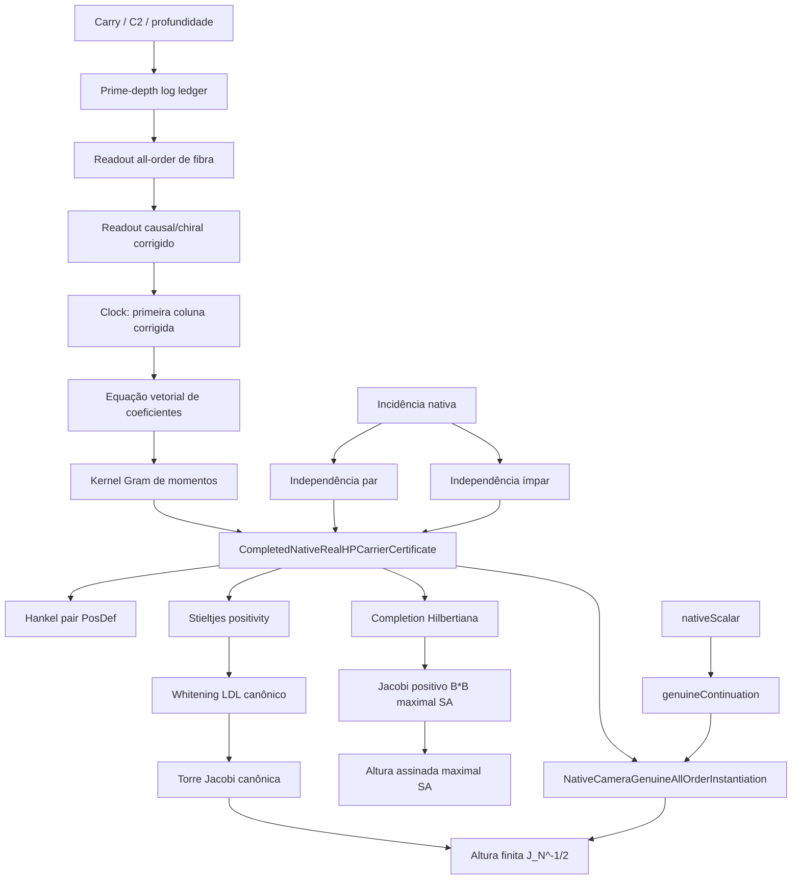

# Carry Self-Adjoint Operator

> [!IMPORTANT]
> **Este repositório é privado e funciona como laboratório + memória histórica do projeto.**
> Ele não deve ser tratado como o futuro repositório público de auditoria.
> O objetivo deste README é deixar a rota canônica fechada impossível de perder no meio das rotas experimentais, no-gos, audits e formalizações históricas.

## TL;DR — o que não podemos esquecer

A rota canônica atual é:

```text
C2 / carry / profundidade / clock
        ↓
readout causal/chiral corrigido
        ↓
equação vetorial de coeficientes
        ↓
kernel de momentos + independência par + independência ímpar
        ↓
CompletedNativeRealHPCarrierCertificate
        ↓
positividade Stieltjes em toda ordem
        ↓
Hankel par + Hankel deslocado positivos definidos
        ↓
whitening LDL canônico
        ↓
torre Jacobi canônica
        ↓
altura finita J_N^(-1/2)
        ↓
completion Hilbertiana
        ↓
operador assinado maximalmente autoadjunto
```

Em paralelo, a identificação de fonte é:

```text
nativeScalar = genuineContinuation
```

e o adapter canônico que junta a câmera nativa/Genuine ao downstream já existente é:

```lean
nativeCameraGenuineAllOrderInstantiation_of_certificate
```

> [!CAUTION]
> O theorem acima **não é sozinho** o theorem de autoadjunticidade infinita.
> Ele fecha a costura câmera/Genuine → momentos/Hankel/Jacobi/altura finita.
> O operador completado maximalmente autoadjunto vem do **mesmo certificado** por
> `CompletedNativeRealHPCarrierCertificate.toReducedMaximalSelfAdjointHeightData`
> e pelo fecho implementado em `GreenJetMaximalAdjointSquare.lean` e
> `GreenJetReciprocalSignedHeightOperator.lean`.

---

## 1. A interface central: o certificado HP real

Arquivo:

```text
CarrySelfAdjointOperator/CompletedNativeHPGateAudit.lean
```

A estrutura canônica é:

```lean
CompletedNativeRealHPCarrierCertificate jet
```

Ela possui **exatamente três campos**:

```text
momentKernel
evenIndependent
oddIndependent
```

Em termos matemáticos:

1. `momentKernel`: os momentos canônicos são realizados por um Gram real de Hilbert;
2. `evenIndependent`: a família par é globalmente linearmente independente;
3. `oddIndependent`: a família ímpar é globalmente linearmente independente.

> [!IMPORTANT]
> **Não existe quarto campo universal no certificado.**
> J/H, pós-T0, Gamma, Herglotz/Pick, theta, uma nova escala Hilbertiana ou uma nova hipótese de positividade
> não são obrigações adicionais depois que um `CompletedNativeRealHPCarrierCertificate` foi fornecido.

O primeiro theorem downstream decisivo é:

```lean
CompletedNativeRealHPCarrierCertificate.hankelPair_posDef
```

que produz, para todo `N`, positividade definida simultânea de:

```lean
hankelGram canonicalCompletedNativeLogDerivativeMoment N
shiftedHankel canonicalCompletedNativeLogDerivativeMoment N
```

O mesmo certificado também produz diretamente os pacotes operatoriais completados:

```lean
CompletedNativeRealHPCarrierCertificate.completedJacobiEnergySelfAdjointData
CompletedNativeRealHPCarrierCertificate.toReducedMaximalSelfAdjointHeightData
```

---

## 2. Onde o certificado é construído pela rota corrigida

Arquivo:

```text
CarrySelfAdjointOperator/CompletedNativeCorrectedClockBoundaryGate.lean
```

O alvo material/corrigido é:

```lean
HasCorrectedNativeSeededClockBoundaryTransport
```

A ponte com a rota Green/clock anterior é:

```lean
hasCorrectedNativeChiralBoundaryTransport_iff_sameEdgeGreenToClockBoundaryTransport
```

A primeira coluna corrigida chega ao ledger e ao momento polarizado por:

```lean
canonicalCompletedC3LedgerBoundary_of_correctedNativeChiralBoundaryTransport
seededClockAtlasCoefficient_firstColumn_eq_correctedNativePolarizedMoment
```

O kernel completo de momentos é construído por:

```lean
seededClockAtlasGreenMomentKernel_of_correctedNativeChiralBoundaryTransport
```

E o constructor concreto que monta o HP certificate é:

```lean
completedNativeRealHPCarrierCertificate_of_correctedNativeChiralBoundaryTransport
```

Seu contrato lógico é, esquematicamente:

```text
HasCorrectedNativeSeededClockBoundaryTransport
        +
LinearIndependent da família par
        +
LinearIndependent da família ímpar
        ↓
CompletedNativeRealHPCarrierCertificate
```

> [!NOTE]
> Esta distinção deve ser preservada para sempre:
> o **downstream depois do certificado está fechado**;
> o theorem que fabrica o certificado mantém explícitas as hipóteses concretas que o alimentam.
> Nunca transformar uma hipótese explícita de um constructor em uma afirmação incondicional por narrativa.

---

## 3. A genealogia natural C2 → fonte → coeficientes → altura

### 3.1 Geometria C2 e relógio

Arquivo principal:

```text
CarrySelfAdjointOperator/C2GeometryNativeSourceBridge.lean
```

Âncora geométrica:

```lean
canonicalC2Geometry_nativeSourceChain
```

Ela registra, na mesma cadeia, a célula C2 alinhada, centro/pernas, profundidade, núcleo ímpar e a decomposição logarítmica com `primeDepthLogLedger`.

Os readouts all-order da câmera são costurados por:

```lean
canonicalC2Geometry_nativeTaylorReadout_eq_seed_add_fibreBrackets
canonicalC2Geometry_logPowerReadout_eq_seed_add_fibreBrackets
```

A cabeça finita e a cauda exata reconstroem o escalar nativo por:

```lean
canonicalC2Geometry_finiteHead_add_exactTail_eq_factor_mul_nativeScalar
canonicalC2Geometry_completedPackagedNativeJet_eq_head_add_exactTail
canonicalC2Geometry_completedPackagedNativeJet_zero_normalized_eq_commonCharacteristic
```

A identificação dos jets e momentos da câmera inclui:

```lean
canonicalC2Geometry_normalizedCamera_iteratedDeriv_eq_common
canonicalC2Geometry_correctedChiralCoefficient_odd_eq_cameraMoment
canonicalC2Geometry_seededClockFirstColumn_eq_cameraPolarizedMoment
canonicalC2Geometry_seededClockGreenMomentKernel_of_correctedTransport
```

### 3.2 Profundidade prima e clock `log n`

Arquivo:

```text
CarrySelfAdjointOperator/PrimeDepthTfvdLogJetCrosswalk.lean
```

Declarações-chave:

```lean
primeDepthLogLedger
primeDepthLogLedger_eq_log
primeDepthLogLedger_eq_factorizationLedger
primeDepthLogLedger_eq_cameraVerticalLedger
c2AlignedCenter_log_eq_currentDepth_add_primeCoreLedger
c2Fiber_centeredLog_amplitude_eq_green_and_primeDepthSeed
```

A identidade conceitual é:

```text
log n = soma_p v_p(n) log p
```

e, numa torre `p^j`, a frequência é `j log p`.

### 3.3 Gerador logarítmico nativo

Arquivo:

```text
CarrySelfAdjointOperator/NativeLogEvolution.lean
```

Declarações-chave:

```lean
nativeLogGenerator
nativeLogGenerator_isSelfAdjoint
nativeLogGenerator_basisVector
nativeLogGenerator_basisVector_log
nativeRealSpectralState_eq_logOrbit_zero
```

Esse bloco registra que o relógio logarítmico não é um ajuste espectral posterior.

---

## 4. Readout causal/chiral corrigido e clock

Arquivo:

```text
CarrySelfAdjointOperator/CompletedNativeCorrectedCausalChiralGate.lean
```

Declarações-chave:

```lean
canonicalCompletedNativeCorrectedChiralBoundaryCoefficient
canonicalCompletedNativeCorrectedChiralBoundaryCoefficient_eq_response
canonicalCompletedNativeCorrectedChiralBoundaryCoefficient_eq_polarizedMoment
canonicalCompletedNativeCorrectedChiralBoundaryCoefficient_odd_eq_canonicalMoment
canonicalCompletedNativeCorrectedCausalChiralBoundaryGate
```

Arquivo de clock/Gram:

```text
CarrySelfAdjointOperator/CompletedNativeClockGreenMomentGate.lean
```

Declarações-chave:

```lean
seededClockAtlasJet
seededClockAtlasCoefficient_eq_inner
canonicalCompletedC3LedgerBoundaryTaylorCoefficient_eq_boundaryTarget
seededClockAtlasCoefficient_equation_of_completedLedgerBoundary
seededClockAtlasGreenMomentKernel_of_completedLedgerBoundary
completedNativeRealHPCarrierCertificate_of_calibratedSeededClockAtlas
```

Arquivo intermediário same-edge:

```text
CarrySelfAdjointOperator/CompletedNativeSameEdgeGreenClockTransport.lean
```

Declarações-chave:

```lean
HasSameEdgeGreenToClockBoundaryTransport
canonicalCompletedC3LedgerBoundary_of_sameEdgeGreenToClockBoundaryTransport
seededClockAtlasGreenMomentKernel_of_sameEdgeGreenToClockBoundaryTransport
completedNativeRealHPCarrierCertificate_of_sameEdgeGreenToClockBoundaryTransport
```

---

## 5. Equação vetorial de coeficientes e independência

### 5.1 Equação vetorial

Arquivo:

```text
CarrySelfAdjointOperator/CompletedNativeCausalCoefficientMomentGate.lean
```

Declarações-chave:

```lean
polarizedCoefficientParityJet
HasPolarizedCoefficientVectorEquation
complexGreenWronskianMomentKernel_of_vectorCoefficientEquation
completedNativeRealHPCarrierCertificate_of_vectorCoefficientEquation
completedNativeRealHPCarrierCertificate_of_coefficientEquation
```

### 5.2 Independência all-order

Arquivo:

```text
CarrySelfAdjointOperator/BR2IncidenceStrictPositivity.lean
```

Declarações-chave:

```lean
BR2BracketIncidenceJetTransport
BR2BracketIncidenceJetTransport.evenPrefix_linearIndependent
BR2BracketIncidenceJetTransport.oddPrefix_linearIndependent
BR2BracketIncidenceJetTransport.even_linearIndependent
BR2BracketIncidenceJetTransport.odd_linearIndependent
```

Essas declarações fornecem a estrita não degenerescência das duas paridades no carrier correto.

---

## 6. Gram → Hankel

Arquivo:

```text
CarrySelfAdjointOperator/GreenWronskianHankelBridge.lean
```

Declarações-chave:

```lean
greenWronskianMomentKernel
IsGreenWronskianMomentKernelGramRepresentation
greenWronskianMomentKernel_even_momentGram
greenWronskianMomentKernel_odd_shiftedMomentGram
greenWronskianMomentKernel_even_odd_orthogonal
hankelPair_posSemidef_of_greenWronskianMomentKernel
hankelPair_posDef_of_greenWronskianMomentKernel
```

Aqui está a razão formal para as duas independências no certificado:

```text
Gram + evenIndependent → Hankel normal PosDef
Gram + oddIndependent  → Hankel deslocado PosDef
```

---

## 7. Momentos canônicos

Arquivo:

```text
CarrySelfAdjointOperator/CompletedNativeRealWeylMoments.lean
```

Declarações-chave:

```lean
canonicalCompletedNativeLogDerivativeMoment
canonicalCompletedNativeLogDerivativeMoment_eq
canonicalCompletedNativeLogDerivativeMoment_real_recurrence
canonicalCompletedNativeLogDerivativeMoment_isMomentSequence
completedNativeLogDerivativeMoment_eq_canonical
```

A sequência `h_n` é determinada pela recorrência division-free da log-derivada da característica completada.

Ela não é ajustada a uma tabela de zeros nem escolhida para produzir um espectro desejado.

---

## 8. Universalidade das câmeras

Arquivo:

```text
CarrySelfAdjointOperator/CompletedNativeCameraUniversality.lean
```

Declarações-chave:

```lean
normalizedCompletedNativeCameraCharacteristic_eq
completedNativeCameraLogDerivativeMoment_eq_canonical
completedNativeCameraLogDerivativeMoment_camera_recurrence
completedNativeCameraLogDerivativeMoment_isMomentSequence
completedNativeCameraUniversality
completedNativeCamera_finiteJacobi_independent
completedNativeCamera_jacobiTower_independent
completedNativeCamera_finiteHeight_independent
```

A mensagem formal é que a escolha da câmera muda a representação, não a sequência canônica de momentos downstream.

---

## 9. Certificate → Stieltjes → torre Jacobi

Arquivo:

```text
CarrySelfAdjointOperator/CanonicalCompletedNativeStieltjesOperator.lean
```

Interface de positividade:

```lean
CanonicalCompletedNativeStieltjesPositivity
```

Ponte principal:

```lean
canonicalCompletedNativeStieltjesPositivity_of_certificate
```

Ou seja:

```text
CompletedNativeRealHPCarrierCertificate
        ↓
CanonicalCompletedNativeStieltjesPositivity
```

Declarações downstream importantes:

```lean
canonicalCompletedNativeStieltjes_hankelGram_posDef
canonicalCompletedNativeStieltjes_shiftedHankel_posDef
canonicalCompletedNativeStieltjesFiniteJacobiTower
canonicalCompletedNativeStieltjesFiniteJacobiTower_isExactPrincipal
canonicalCompletedNativeStieltjesJacobiTowerLimitMatrix
canonicalCompletedNativeStieltjesJacobiEnergyOperator
canonicalCompletedNativeStieltjesJacobiEnergySelfAdjointData
canonicalCompletedNativeStieltjesReducedSignedHeightData
```

Existe também a volta puramente momental:

```lean
completedNativeRealHPCarrierCertificate_of_stieltjesPositivity
canonicalCompletedNativeStieltjesPositivity_iff_nonempty_carrier
```

Essa volta é uma equivalência de interfaces; não deve ser confundida com a genealogia geométrica original do certificado.

---

## 10. Whitening LDL, Jacobi e altura finita

### 10.1 Whitening canônico

Arquivo:

```text
CarrySelfAdjointOperator/CanonicalLDLWhitening.lean
```

Declarações-chave:

```lean
LDL_diagEntries_pos
canonicalLDLScale
canonicalLDLInverseFactor
canonicalLDLInverseFactor_whitens
canonicalHankelWhitening
```

### 10.2 Compatibilidade entre cutoffs

Arquivo:

```text
CarrySelfAdjointOperator/CanonicalLDLPrefixReduction.lean
```

Declarações-chave:

```lean
canonicalLDLPrincipalCompatible
canonicalFiniteJacobiSection_isExactPrincipalTower_unconditional
canonicalJacobiTowerLimitMatrix
canonicalJacobiTowerLimitMatrix_submatrix_unconditional
```

### 10.3 Operador finito positivo

Arquivo:

```text
CarrySelfAdjointOperator/CanonicalFiniteHeight.lean
```

Declarações-chave:

```lean
canonicalFiniteJacobiSection
canonicalFiniteJacobiSection_posDef_of_shiftedGram
canonicalFiniteHeightOperator
canonicalFiniteHeightOperator_isSymm
canonicalFiniteHeightOperator_charpoly
```

A construção é a leitura funcional:

```text
T_N = J_N^(-1/2)
```

### 10.4 Operador finito assinado

Arquivo:

```text
CarrySelfAdjointOperator/SignedFiniteHeightOperator.lean
```

Declarações-chave:

```lean
canonicalSignedFiniteHeightOperator
canonicalSignedFiniteHeightOperator_isSymm
canonicalSignedFiniteHeightOperator_charpoly
signedSectorReflection_conj_canonicalSignedFiniteHeightOperator
```

---

## 11. Proveniência câmera → momentos → Jacobi → altura

Arquivo:

```text
CarrySelfAdjointOperator/CompletedNativeGeometryHeightProvenance.lean
```

Declarações que devem ser lembradas:

```lean
nativeGeometry_normalizedCamera_eq_commonCharacteristic
nativeGeometry_cameraMoments_eq_canonical
nativeGeometry_cameraHankelPair_eq_canonical
nativeGeometry_cameraJacobiSection_eq_canonical
nativeGeometryFiniteHeightOperator
nativeGeometryFiniteHeightOperator_isSymm
nativeGeometryFiniteHeightOperator_eq_of_greenMomentKernel
nativeGeometry_to_finiteHeight_chain
nativeGeometry_to_finiteHeight_chain_of_greenMomentKernel_and_incidenceTransport
nativeGeometryFiniteHeightOperator_eq_of_greenMomentKernel_and_incidenceTransport
```

Esse arquivo é a costura que impede a narrativa errada de que o Jacobi/height foi 'escolhido':

```text
momentos canônicos
→ Hankel canônico
→ whitening canônico
→ Jacobi canônico
→ altura canônica
```

---

## 12. Capstone natural C2 → height

Arquivo:

```text
CarrySelfAdjointOperator/CompletedNativeCorrectedGeometryHeightProvenance.lean
```

Declarações principais:

```lean
canonicalC2Geometry_correctedNative_to_finiteHeight_chain
canonicalC2Geometry_correctedNative_greenKernel_before_height
canonicalC2Geometry_correctedNative_greenKernel_eq_canonical
canonicalC2Geometry_correctedNative_coefficientEquation_before_gram
canonicalC2Geometry_height_chain_of_coefficientEquation_and_incidenceTransport
canonicalC2Geometry_natural_source_to_height_operator
canonicalC2Geometry_height_chain_of_centerLegGreenCertificate
canonicalC2Geometry_height_chain_of_tfvdGreenCenterLegReadout
```

O capstone mais importante para a genealogia é:

```lean
canonicalC2Geometry_natural_source_to_height_operator
```

Ele registra a direção correta:

```text
geometria nativa
→ brackets/fibras
→ cabeça + cauda exata
→ característica completada
→ equação polarizada de coeficientes
→ positividade
→ Jacobi
→ operador de altura finito
```

> [!IMPORTANT]
> Este theorem mantém explícitos os inputs materiais que ainda aparecem no seu tipo.
> Não usar a palavra 'incondicional' sem antes conferir o tipo Lean exato.

---

## 13. Native scalar = Genuine

Arquivo:

```text
CarrySelfAdjointOperator/NativeScalarGenuineIdentification.lean
```

Identidades estruturais:

```lean
centerBracketTerm_three_eq_realCpSaturatedBracket
seedDirichletTerm_three_eq_genuineSeed
bracketCharacteristic_three_eq_bracketedDirichletChart_native
finiteBracketCharacteristic_three_eq_finiteBracketedDirichletChart
```

Capstone:

```lean
nativeScalar_eq_genuineContinuation_unconditional
```

com conteúdo:

```text
∀ s : ℂ, nativeScalar s = genuineContinuation s
```

A identificação é direta pela geometria/carta camera-3 e não precisa de uma passagem por uma função meromorfa externa para ser enunciada.

---

## 14. Adapter câmera/Genuine para a maquinaria all-order

Arquivo:

```text
CarrySelfAdjointOperator/NativeCameraGenuineAllOrderInstantiation.lean
```

Declarações:

```lean
nativeCameraGenuineAllOrderInstantiation
nativeCameraGenuineAllOrderInstantiation_of_certificate
```

O segundo é o entry point canônico:

```text
CompletedNativeRealHPCarrierCertificate
        ↓
nativeScalar = genuineContinuation
camera moments = canonical moments
camera Hankel pair = canonical Hankel pair
camera Jacobi = canonical Jacobi
same finite height matrix
```

Internamente ele reutiliza:

```lean
certificate.momentKernel
certificate.oddIndependent
canonicalCompletedNativeStieltjesPositivity_of_certificate certificate
```

`certificate.evenIndependent` continua sendo materialmente usado dentro da ponte certificate → Stieltjes, via `certificate.hankelPair_posDef`.

---

## 15. Completion e operador maximalmente autoadjunto

### 15.1 Jacobi positivo completado

Arquivo:

```text
CarrySelfAdjointOperator/GreenJetMaximalAdjointSquare.lean
```

Declarações essenciais:

```lean
closedGreenJetEnergyAdjointSquare
closedGreenJetEnergyAdjointSquare_finiteCompression_eq_canonicalSection
closedGreenJetEnergyAdjointSquare_dense_domain
closedGreenJetEnergyAdjointSquare_isMaximalRealSelfAdjoint
closedGreenJetEnergyAdjointSquare_isClosed
closedGreenJetEnergyAdjointSquare_inner_nonneg
```

### 15.2 Altura assinada completada

Arquivo:

```text
CarrySelfAdjointOperator/GreenJetReciprocalSignedHeightOperator.lean
```

Declarações essenciais:

```lean
closedGreenJetReducedReciprocalSignedHeightData
closedGreenJetReducedReciprocalSignedHeightOperator
closedGreenJetReducedReciprocalSignedHeightOperator_adjoint_eq
canonicalCompletedGreenJetReducedReciprocalSignedHeightData
canonicalCompletedGreenJetReducedReciprocalSignedHeightOperator_adjoint_eq
```

É esse bloco que registra a autoadjunticidade maximal da altura assinada completada.

### 15.3 Entry point pelo HP certificate

De volta a:

```text
CarrySelfAdjointOperator/CompletedNativeHPGateAudit.lean
```

o certificate fornece diretamente:

```lean
CompletedNativeRealHPCarrierCertificate.toReducedMaximalSelfAdjointHeightData
CompletedNativeRealHPCarrierCertificate.completedJacobiEnergySelfAdjointData
```

Portanto o downstream completado depende da mesma interface de três campos.

---

## 16. Mapa visual completo



---

## 17. Os nomes que precisamos conseguir recitar de memória

| Pergunta | Declaration canônica |
|---|---|
| De onde vem a geometria C2 concreta? | `canonicalC2Geometry_nativeSourceChain` |
| Onde a fonte corrigida vira equação pré-Gram? | `canonicalC2Geometry_correctedNative_coefficientEquation_before_gram` |
| Qual é o alvo material do clock? | `HasCorrectedNativeSeededClockBoundaryTransport` |
| Onde o clock corrigido vira kernel de momentos? | `seededClockAtlasGreenMomentKernel_of_correctedNativeChiralBoundaryTransport` |
| Onde as três obrigações viram certificate? | `completedNativeRealHPCarrierCertificate_of_correctedNativeChiralBoundaryTransport` |
| Qual é a interface central? | `CompletedNativeRealHPCarrierCertificate` |
| Onde o certificate vira Hankel PosDef? | `CompletedNativeRealHPCarrierCertificate.hankelPair_posDef` |
| Onde o certificate vira Stieltjes? | `canonicalCompletedNativeStieltjesPositivity_of_certificate` |
| Onde está a genealogia C2 → height? | `canonicalC2Geometry_natural_source_to_height_operator` |
| Onde Native = Genuine? | `nativeScalar_eq_genuineContinuation_unconditional` |
| Onde Genuine/câmera consome o certificate? | `nativeCameraGenuineAllOrderInstantiation_of_certificate` |
| Onde o certificate produz Jacobi SA completado? | `CompletedNativeRealHPCarrierCertificate.completedJacobiEnergySelfAdjointData` |
| Onde o certificate produz altura assinada SA completada? | `CompletedNativeRealHPCarrierCertificate.toReducedMaximalSelfAdjointHeightData` |
| Qual theorem-base prova SA do bloco assinado? | `closedGreenJetReducedReciprocalSignedHeightOperator_adjoint_eq` |

---

## 18. O que NÃO faz parte da rota canônica fechada

Os seguintes clusters permanecem úteis como história, auditoria, rotas alternativas, no-gos ou investigação, mas **não devem ser colocados entre o HP certificate e o operador**:

- certificados numéricos/analíticos baseados em theta;
- `XiTheta*`, quadraturas de primeira moda theta e bounds racionais de cauda;
- Bernstein/eighth/tenth-order low-order certificates;
- Gamma radial cru;
- Herglotz/Pick como fonte alternativa de positividade;
- J/H e pós-T0 como genealogia adicional do clock/proveniência;
- raw seeded-clock one-block no-go;
- costuras alternativas C3 que foram formalmente refutadas;
- experimentos em `research/`, `tmp/`, `.bak`, scripts e datasets de exploração.

> [!NOTE]
> Alguns desses arquivos continuam no repositório e isso é desejável: este repositório é o laboratório histórico.
> O ponto é apenas não confundi-los com a espinha dorsal que deve ser extraída para o futuro repositório limpo.

### Theta em particular

A antiga rota theta serviu para certificados analíticos/numéricos de baixa ordem e consequências associadas.
Ela não é a fonte da interface HP atual.
Seus arquivos podem permanecer disponíveis para auditoria histórica, mas não precisam ser importados pelo umbrella canônico da prova atual.

---

## 19. Guardrails lógicos

### Guardrail A — não confundir constructor com hipótese descarregada

`completedNativeRealHPCarrierCertificate_of_correctedNativeChiralBoundaryTransport` é um theorem real e importante, mas possui inputs explícitos.
Antes de escrever 'o certificate concreto é incondicional', conferir o tipo Lean e verificar onde cada input é provado.

### Guardrail B — não criar um quarto requisito

Depois de obter:

```lean
certificate : CompletedNativeRealHPCarrierCertificate jet
```

o downstream não exige uma nova teoria J/H, Gamma, Herglotz, Pick ou theta.

### Guardrail C — Green e Genuine não são o mesmo canal

Genuine é o canal de readout/resultante e pode zerar.
Green é o canal de energia/confinamento/Gram.
Não reintroduzir a narrativa de 'zeros de Green'.

### Guardrail D — não ajustar o operador a zeros

A cadeia formal é:

```text
característica nativa
→ momentos
→ Hankel
→ Jacobi
→ altura
```

Não existe entrada 'zero table', 'target heights' ou Jacobi fitted na construção canônica.

### Guardrail E — finito e completado são duas camadas

`nativeCameraGenuineAllOrderInstantiation_of_certificate` fecha a identificação finita/canônica.
A autoadjunticidade completada é fornecida separadamente pelo mesmo certificate.

---

## 20. Ordem recomendada para construir o futuro repositório de auditoria

Quando este laboratório for reduzido a um repositório limpo, começar pela seguinte sequência e adicionar dependências somente quando o compilador exigir:

1. `NativeLogEvolution.lean`
2. `PrimeDepthTfvdLogJetCrosswalk.lean`
3. `C2LiteralCameraAllOrderJetCrosswalk.lean`
4. `C2GeometryNativeSourceBridge.lean`
5. `CompletedNativeCorrectedCausalChiralGate.lean`
6. `CompletedNativeClockGreenMomentGate.lean`
7. `CompletedNativeSameEdgeGreenClockTransport.lean`
8. `CompletedNativeCorrectedClockBoundaryGate.lean`
9. `CompletedNativeCausalCoefficientMomentGate.lean`
10. `BR2IncidenceStrictPositivity.lean`
11. `GreenWronskianHankelBridge.lean`
12. `CompletedNativeRealWeylMoments.lean`
13. `CompletedNativeHPGateAudit.lean`
14. `CanonicalCompletedNativeStieltjesOperator.lean`
15. `CanonicalLDLWhitening.lean`
16. `CanonicalLDLPrefixReduction.lean`
17. `CanonicalFiniteHeight.lean`
18. `SignedFiniteHeightOperator.lean`
19. `CompletedNativeCameraUniversality.lean`
20. `CompletedNativeGeometryHeightProvenance.lean`
21. `CompletedNativeCorrectedGeometryHeightProvenance.lean`
22. `NativeScalarGenuineIdentification.lean`
23. `NativeCameraGenuineAllOrderInstantiation.lean`
24. `GreenJetMaximalAdjointSquare.lean`
25. `GreenJetReciprocalSignedHeightOperator.lean`

> [!TIP]
> No repositório novo, cada arquivo deve entrar porque existe uma aresta explícita no dependency graph.
> Se um módulo só documenta uma rota refutada, uma certificação theta antiga ou um experimento, deixá-lo de fora da primeira versão.

---

## 21. Comandos úteis para reencontrar a rota em segundos

```bash
rg -n 'CompletedNativeRealHPCarrierCertificate' CarrySelfAdjointOperator
rg -n 'completedNativeRealHPCarrierCertificate_of_correctedNativeChiralBoundaryTransport' CarrySelfAdjointOperator
rg -n 'canonicalCompletedNativeStieltjesPositivity_of_certificate' CarrySelfAdjointOperator
rg -n 'canonicalC2Geometry_natural_source_to_height_operator' CarrySelfAdjointOperator
rg -n 'nativeCameraGenuineAllOrderInstantiation_of_certificate' CarrySelfAdjointOperator
rg -n 'toReducedMaximalSelfAdjointHeightData' CarrySelfAdjointOperator
rg -n 'closedGreenJetReducedReciprocalSignedHeightOperator_adjoint_eq' CarrySelfAdjointOperator
```

Para procurar escapes de confiança:

```bash
rg -n '\bsorry\b|\badmit\b|sorryAx|admitAx' CarrySelfAdjointOperator
```

---

## 22. Estado canônico desta documentação

Esta versão do README foi consolidada em **18 de setembro de 2026** para servir como checkpoint interno do repositório privado.

O ponto principal a preservar é:

```text
ROTA GEOMÉTRICA / GRAM
        ↓
CompletedNativeRealHPCarrierCertificate
        ↓
ROTA HANKEL / JACOBI / OPERADOR
```

e, no lado de representação:

```text
nativeScalar = genuineContinuation
        ↓
nativeCameraGenuineAllOrderInstantiation_of_certificate
```

### Frase-resumo

> **O operador não é ajustado para reproduzir os momentos ou uma tabela de zeros; os momentos canônicos da geometria determinam o Hankel, o Jacobi e a altura, e o HP certificate autentica a realização Hilbertiana positiva e não degenerada necessária para que essa construção passe ao operador maximalmente autoadjunto.**

---

## 23. Regra para qualquer agente futuro

Antes de anunciar um 'novo gargalo' depois do HP certificate:

1. abrir este README;
2. abrir `CompletedNativeHPGateAudit.lean`;
3. abrir `NativeCameraGenuineAllOrderInstantiation.lean`;
4. verificar se o suposto novo requisito aparece realmente no tipo Lean do certificate ou do theorem downstream;
5. se não aparece, tratá-lo como rota auxiliar/proveniência adicional, não como nova obrigação da prova.

Isso existe para impedir que a linha de chegada seja movida por perda de contexto.
