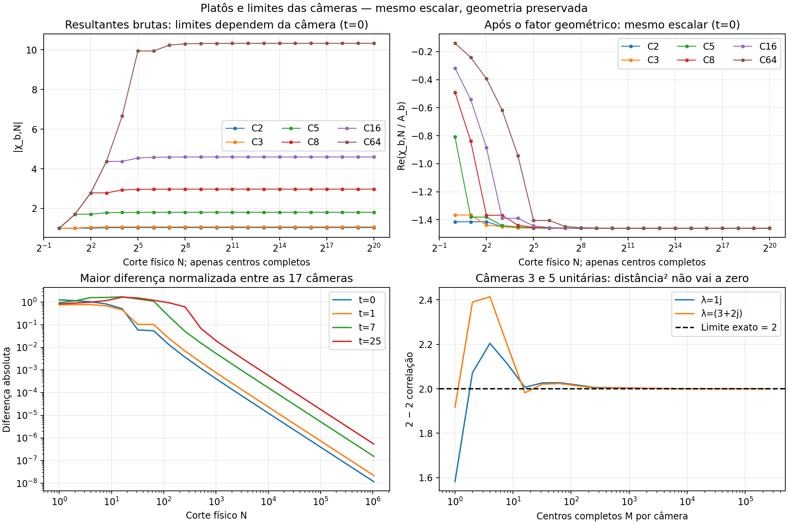

# Mapa — platôs das câmeras e convergência com o corte

Data: 2026-09-05

Base: dba85c68854b3c351a5848af286eff04f2df1235

Branch: agent/camera-centered-cutoff-convergence

## Resultado do palpite

Para cada câmera fixa, a leitura escalar, dividida pelo fator geométrico próprio daquela câmera, converge para o mesmo escalar nativo. Isso vale também quando todas as câmeras recebem o mesmo corte físico N e cada uma conserva somente seus centros completos.

O platô inicial tem uma origem precisa: a semente pode estar completa antes de caber o primeiro centro com suas duas pernas. A geometria determina esse intervalo.

O estado Hilbert completo conserva as diferenças entre as câmeras. A mesma leitura escalar limite não implica igualdade entre seus vetores. As câmeras 3 e 5 fornecem um exemplo rigoroso: a distância quadrada entre as linhas de leitura unitariamente normalizadas tende a 2.

Esses resultados reutilizam o escalar, o Gram, a realização Naimark e o operador logarítmico existentes. Não foi construído outro operador espectral ou outra Jacobi.

## 1. Qual corte foi usado

Defina a inclinação e o maior raio:

$$
\ell_b=
\begin{cases}
4,&b=2,\\
b,&b>2,
\end{cases}
\qquad
h_b=
\begin{cases}
1,&b=2,\\
\lfloor b/2\rfloor,&b>2.
\end{cases}
$$

Com corte físico N, o número de centros completos é

$$
M_b(N)=\left\lfloor\frac{(N-h_b)_+}{\ell_b}\right\rfloor.
$$

Cada centro contado mantém todas as pernas e todos os raios da câmera. A câmera par inclui o raio antipodal, com sua multiplicidade correta. O coeficiente do extremo direito mantém a correção de uma unidade quando necessária.

A semente ocupa as posições 1 até h_b. Quando

$$
h_b\le N<\ell_b+h_b,
$$

ela já está completa e nenhum centro completo entrou. Nesse intervalo a resultante permanece no valor da semente: é um platô inicial geométrico, não um efeito de precisão numérica.

| Câmera | Semente completa em N | Primeiro centro completo em N | Intervalo inicial sem novos centros |
| --- | ---: | ---: | --- |
| 2 alinhada | 1 | 5 | 1 até 4 |
| 3 | 1 | 4 | 1 até 3 |
| 5 | 2 | 7 | 2 até 6 |
| 8 | 4 | 12 | 4 até 11 |
| 16 | 8 | 24 | 8 até 23 |
| 64 | 32 | 96 | 32 até 95 |

**Lean novo:** completeCameraCenterCount_initialPlateau e completeCameraCenterCount_tendsto. O primeiro prova que M_b(N)=0 antes do primeiro centro completo. O segundo prova M_b(N)→∞ para toda câmera b≥2 fixa.

Para N<h_b, o laboratório mantém apenas os elementos da semente que cabem no corte. A expressão Lean finiteBracketCharacteristic contém a semente inteira. Ambas as convenções coincidem a partir de N≥h_b; essa diferença inicial não altera o limite.

## 2. O que converge para o mesmo escalar

A resultante usada no laboratório é a própria soma de semente e brackets completos:

$$
\chi_{b,M}(s)=
\sum_{r=1}^{h_b}r^{-s}
+
\sum_{m=1}^{M}\sum_{r=1}^{h_b}
\big[(\ell_bm-r)^{-s}-2(\ell_bm)^{-s}+(\ell_bm+r)^{-s}\big].
$$

A C2 usa $\ell_2=4,h_2=1$. O parâmetro angular é $s=1/2+it$.

Os teoremas existentes demonstram convergência da série e fatoração

$$
\chi_b(s)=A_b(s)\,\mathcal Z_{\rm nat}(s).
$$

Aqui $\mathcal Z_{\rm nat}$ é o nativeScalar já definido pela câmera 3. Não usamos uma função externa, uma lista de zeros ou uma curva ajustada como referência.

Os fatores existentes são

$$
A_2(s)=(1+2^{-s})(1-2^{1-s}),
$$

$$
A_b(s)=1-b^{1-s}\quad (b>2\text{ ímpar}),
$$

$$
A_b(s)=1+(b/2)^{-s}-(b+2)b^{-s}
\quad (b>2\text{ par}).
$$

Eles não dependem do corte. Na linha nativa são não nulos, por factor_nativeLine_ne_zero. Portanto,

$$
\boxed{
\frac{\chi_{b,M_b(N)}(1/2+it)}{A_b(1/2+it)}
\longrightarrow
\mathcal Z_{\rm nat}(1/2+it).
}
$$

**Lean novo:** finiteCamera_normalizedPhysicalCutoff_tendsto. A versão com duas câmeras, finiteCamera_normalizedPhysicalCutoff_pairwise_tendsto, prova que a diferença das leituras normalizadas tende a zero.

A resultante bruta mantém o fator da câmera. A redução exata também foi formalizada:

$$
\chi_{b,M}(s)-\chi_{c,M}(s)
\longrightarrow
\big(A_b(s)-A_c(s)\big)\mathcal Z_{\rm nat}(s).
$$

**Lean novo:** finiteCamera_rawDifference_tendsto. Essa identidade especifica precisamente o que permanece depois de crescer o corte.

A taxa existente para cada câmera e t fixos é O(M^{-3/2}), com constante explícita nativeTailConstant. A normalização usa o fator completo, inclusive sua fase complexa. Não é uma divisão pela energia ou uma calibração pelo primeiro momento.

O enunciado fixa b enquanto N cresce. Não se afirmou convergência uniforme sobre todas as bases b crescendo simultaneamente com o corte.

## 3. Testes no servidor

Câmeras: 2 até 16, mais 32 e 64; total de 17.

Parâmetros angulares: t=0,1,7,25, escolhidos como pontos de teste, sem usar alturas de zeros.

Cortes físicos: N=1,2,4,...,1.048.576. Todos os centros emitidos são completos.

A tabela mede a maior diferença absoluta entre quaisquer duas resultantes normalizadas. Não é o erro em relação a uma curva externa.

| N | t=0 | t=1 | t=7 | t=25 |
| ---: | ---: | ---: | ---: | ---: |
| 64 | 5,45×10⁻² | 1,04×10⁻¹ | 1,11 | 1,22 |
| 1.024 | 3,99×10⁻⁴ | 7,46×10⁻⁴ | 5,25×10⁻³ | 1,90×10⁻² |
| 16.384 | 5,96×10⁻⁶ | 1,12×10⁻⁵ | 7,88×10⁻⁵ | 2,75×10⁻⁴ |
| 1.048.576 | 1,16×10⁻⁸ | 2,17×10⁻⁸ | 1,54×10⁻⁷ | 5,36×10⁻⁷ |

Em t=0 e no corte final, a diferença máxima das resultantes brutas ainda é aproximadamente 9,30. Os valores normalizados se aproximam, enquanto os fatores geométricos próprios permanecem nas leituras brutas.

O experimento verificou:

- 68 matrizes/linhas de coeficientes contra o construtor original native.build_camera_model e collective.native_camera_row, por igualdade exata dos coeficientes.
- As mesmas linhas contra a soma literal das sementes e dos brackets, em dois valores de t.
- Seis avaliações independentes com mpmath a 60 dígitos, comparadas à avaliação estável usada no corte grande.
- Nenhuma chamada a zeros, zeta ou fitting. Os módulos antigos copiados como referência só fornecem os construtores de câmeras utilizados.

O cálculo de corte grande avalia a diferença segunda com expm1 e log1p para reduzir o cancelamento numérico. As posições, multiplicidades, sementes e bordos continuam sendo os do construtor original.

[Figura em PDF](../research/camera-centered-cutoff-2026-09-05/camera_cutoff_convergence.pdf)

## 4. O que a covariância conserva

A covariância com métrica de retorno possui outro parâmetro, $\lambda\notin\mathbb R$, independente de t:

$$
\Sigma_M(\lambda)
=
\frac{C_M\,\operatorname{diag}(|\lambda-\log n|^{-2})\,C_M^T}
{\sum_{n=1}^{M}|\lambda-\log n|^{-2}}.
$$

O M desta expressão conta centros completos por câmera, conforme a convenção existente. Seu suporte chega a $\ell_bM+h_b$. Ele não é o corte físico N da tabela anterior.

O teorema existente tendsto_resolvent_finiteCoefficientCovariance prova

$$
\Sigma_M(\lambda)\longrightarrow G.
$$

O limite do atlas é único; suas entradas ainda dependem das câmeras. Em particular,

$$
G_{3,3}=6,\qquad G_{5,5}=20,\qquad G_{3,5}=0.
$$

Assim, mesmo após normalizar cada linha pela sua própria norma finita,

$$
\boxed{
2-
2\frac{(\Sigma_M)_{3,5}}
{\sqrt{(\Sigma_M)_{3,3}(\Sigma_M)_{5,5}}}
\longrightarrow2.
}
$$

**Lean novo:** finiteCamera_three_five_unitSeparation_tendsto. A expressão é a distância quadrada entre as duas linhas unitárias quando as normas são não nulas; isso ocorre eventualmente, pois as diagonais tendem a 6 e 20.

No experimento, com M=262.144, encontramos:

| λ fixo | Distância² unitária entre câmeras 3 e 5 | Erro de $G^{-1/2}\Sigma_MG^{-1/2}$ para I, norma 2 |
| --- | ---: | ---: |
| i | 2,00004527 | 0,3063 |
| 3+2i | 2,00004981 | 0,3763 |

A covariância completa ainda não estava próxima de seu limite em todas as direções. Não interpretamos esse corte como convergência numérica já encerrada. A divisão pelas massas logarítmicas produz uma estabilização bem mais lenta que a das resultantes; a existência do limite vem do teorema Lean, não de um platô aparente do gráfico.

Normalizar uma diagonal para 1 também não torna todos os produtos cruzados iguais a 1. A geometria conserva direções distintas, mesmo quando seus observadores escalares revelam o mesmo escalar comum.

## 5. Avanço da rota dos perfis centrados

O perfil centrado já existia, em Infinite/WeylUnbounded.lean:

$$
\eta_b
=
Y\phi_b-(\log\ell_b)\phi_b,
\qquad
\phi_b=\mathbf1_{(0,\ell_b]}\,r_b.
$$

Y é o operador logarítmico existente. Sua norma preservada na diagonal também já estava provada.

A peça nova foi demonstrar todos os cruzamentos:

$$
\boxed{\langle\eta_b,\eta_c\rangle=G_{bc}.}
$$

**Lean novo:** inner_centeredNaimarkCameraVector. A integral decisiva é

$$
\int_0^{\min(b,c)}
(1+\log x-\log b)(1+\log x-\log c)\,dx
=\min(b,c).
$$

Ela vale para b,c reais positivos; o menor suporte faz um dos fatores de deslocamento de bordo desaparecer na fórmula integrada. A prova trata o cruzamento inteiro.

Isso permitiu estender a síntese desses mesmos perfis ao CameraHilbert já existente:

$$
U_{\mathrm{cent}}:\mathrm{CameraHilbert}\longrightarrow
\mathrm{NaimarkSpace},
\qquad
\langle U_{\mathrm{cent}}q,U_{\mathrm{cent}}x\rangle
=\langle q,x\rangle.
$$

**Lean novo:** centeredCameraIsometry e centeredCameraIsometry_readout.

O domínio dessa aplicação isométrica é o CameraHilbert inteiro. Não se afirmou que todo elemento da imagem pertença ao domínio do operador logarítmico não limitado; a fórmula com Y é verificada nos vetores de câmera que já têm domínio demonstrado e depois a síntese é estendida por continuidade.

O teorema centeredCameraIsometry_twoQuadrature_readout conserva também as leituras formadas pelas duas quadraturas reais de uma fonte complexa. Assim, um observador via vetor de Riesz pode ser transportado junto com o estado.

A aplicação vale para o dual do trace encontrado na rodada anterior, sem trocar sua normalização. A igualdade desse trace transportado com outro readout de bordo continua exigindo a identificação específica entre observadores; preservar o produto interno não fornece essa igualdade automaticamente.

## 6. Cadeia reutilizada e localização

Módulo novo: [CenteredCameraCutoffConvergence.lean](../CarrySelfAdjointOperator/CenteredCameraCutoffConvergence.lean).

| Resultado | Cadeia de fontes reutilizada |
| --- | --- |
| Cruzamentos dos perfis centrados | centeredNaimarkCameraVector_coeFn → integrais de StepDensity → inner_kolmogorovVector → gramKernel |
| Extensão isométrica | Cruzamentos novos → gramForm → CameraFinsupp → cameraEmbedding_denseRange → ContinuousLinearMap.extend |
| Convergência escalar normalizada | finiteBracketCharacteristic_tendstoLocallyUniformlyOn → bracketCharacteristic_eq_factor_mul_nativeScalar → factor_nativeLine_ne_zero |
| Corte físico comum | Contagem exata de centros completos → completeCameraCenterCount_tendsto → convergência normalizada existente |
| Taxa de cauda | bracketCharacteristic_nativeLine_tail_le, em Camera/QuantitativeTail.lean |
| Covariância e separação | tendsto_resolvent_finiteCoefficientCovariance_apply → sixCameraGram → continuidade das operações de normalização |
| Reconstrução TFVD existente | nativeGpreFiniteTfvdReconstruction_comp_analysis; mantém o papel separado de análise e observador |
| Característica completada | normalizedCompletedNativeCameraCharacteristic_eq já prova igualdade exata por câmera/cutoff; não foi reprovada |
| Momentos e Jacobi existentes | completedNativeCameraLogDerivativeMoment_eq_canonical; comparações de Jacobi preservam suas hipóteses de positividade já explícitas |

As fontes NativeCarrySpectralWeyl foram consultadas no pin 298d83c9351e308a5213b9f5ac32e44087f98a9f. Nenhuma dependência foi atualizada.

Fontes diretas no pin consumido:

- [Perfis centrados e norma diagonal existentes](https://github.com/thiagomassensini/native-carry-spectral-weyl/blob/298d83c9351e308a5213b9f5ac32e44087f98a9f/NativeCarrySpectralWeyl/Infinite/WeylUnbounded.lean).
- [Realização original e extensão ao Hilbert](https://github.com/thiagomassensini/native-carry-spectral-weyl/blob/298d83c9351e308a5213b9f5ac32e44087f98a9f/NativeCarrySpectralWeyl/Infinite/Naimark.lean).
- [Convergência da série de brackets](https://github.com/thiagomassensini/native-carry-spectral-weyl/blob/298d83c9351e308a5213b9f5ac32e44087f98a9f/NativeCarrySpectralWeyl/Camera/NormalConvergence.lean).
- [Fatoração pelo escalar nativo](https://github.com/thiagomassensini/native-carry-spectral-weyl/blob/298d83c9351e308a5213b9f5ac32e44087f98a9f/NativeCarrySpectralWeyl/Camera/CommonZeroSet.lean).
- [Não anulamento dos fatores na linha nativa](https://github.com/thiagomassensini/native-carry-spectral-weyl/blob/298d83c9351e308a5213b9f5ac32e44087f98a9f/NativeCarrySpectralWeyl/Camera/NativeLineFloor.lean).
- [Estimativa explícita da cauda](https://github.com/thiagomassensini/native-carry-spectral-weyl/blob/298d83c9351e308a5213b9f5ac32e44087f98a9f/NativeCarrySpectralWeyl/Camera/QuantitativeTail.lean).
- [Covariância completa com os bordos finitos](https://github.com/thiagomassensini/native-carry-spectral-weyl/blob/298d83c9351e308a5213b9f5ac32e44087f98a9f/NativeCarrySpectralWeyl/Limits/FiniteDefectCovariance.lean).

Notas-guia: NATIVE_CARRY_DYNAMIC_SECTOR_LIMIT_THEOREM.md, UNICIDADE_LIMITE_COVARIANCIA_DEFECT_PROBES.md e o mapa da rodada anterior. O estatuto das provas foi conferido nos arquivos Lean, sem tomar os rótulos antigos das notas como premissas.

## 7. Próximo passo que estes resultados sustentam

Há agora uma realização centrada isométrica em todas as câmeras, não apenas a conservação matricial do pacote de seis. Ela preserva as direções novas que surgem ao ampliar o atlas.

O passo seguinte é calcular a compressão entre a realização original e essa realização centrada, com os domínios apropriados, e identificar nela os setores de retorno. O transporte de um readout já está disponível; a comparação entre dois readouts específicos permanece uma obrigação separada.

O palpite sobre os cortes ajuda a organizar essa etapa: separar o tempo necessário para aparecerem centros completos, a convergência rápida da resultante normalizada e a convergência mais lenta da covariância completa. Essas três escalas não devem ser inferidas de um único gráfico.

## 8. Validação e entrega

A rodada contém 19 teoremas públicos novos e quatro aplicações lineares/isométricas para sintetizar e estender os perfis já existentes. Não há outro operador espectral, outra sequência de momentos ou outra Jacobi.

Os registros de build, axiomas, fontes e testes estão em [research/camera-centered-cutoff-2026-09-05](../research/camera-centered-cutoff-2026-09-05/).

**Validação concluída:** 14/14 estágios de scripts/audit.sh passaram com exit code 0 e sem warnings. Os 19 teoremas foram conferidos em #check e #print axioms; somente propext, Classical.choice e Quot.sound aparecem no conjunto transitivo, sem sorryAx. Os 15 pins e oito arquivos-base foram conferidos sem alteração. O laboratório terminou com exit code 0; as figuras foram inspecionadas.

A igualdade Gamma/native Gram não foi estabelecida nem usada como hipótese. O commit permanece em branch separada, sem merge.
