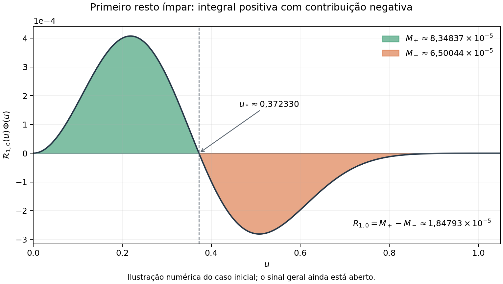

# Restos da fonte como integrais theta: avanço e obstrução em toda ordem

Data: 14 de outubro de 2026. Base: `40e0cf4867c575c7880bc8706ff7d58c90a3b3a5` do repositório `carry-self-adjoint-operator`, após o PR #92.

O próximo alvo era derivar uma representação positiva dos restos explícitos da fonte, preservando a completação e todos os acoplamentos. Obtivemos uma representação integral exata em toda ordem, com a medida positiva original da fonte. Porém, a densidade dessa representação tem uma contribuição negativa inevitável em todo o setor ímpar. Isso não contradiz a positividade dos restos: demonstra que esta representação exige comparar massas de sinais opostos.

O resultado geral novo é uma redução formalizada:

\[
R_{s,n}=M_+(\mathcal R_{s,n})-M_-(\mathcal R_{s,n}),
\qquad
R_{s,n}>0\iff M_-(\mathcal R_{s,n})<M_+(\mathcal R_{s,n}).
\]

Além disso, foi provado em Lean que \(M_-(\mathcal R_{1,n})>0\) para **todo** \(n\). A dominância geral de \(M_+\) permanece aberta. No primeiro caso ímpar, Lean prova a dominância estrita usando a desigualdade de curtose da fonte já existente; uma quadratura Arb externa também calcula separadamente as duas massas.

Usamos exatamente

\[
\Phi(u)=\mathrm{completedNativeXiCosineKernel}(u)>0\quad(u\geq0),
\qquad
\mu_j=\int_0^\infty u^{2j}\Phi(u)\,du,
\qquad
c_j=\frac{(-1)^j\mu_j}{(2j)!}.
\]

Aqui \(c_j\) são os coeficientes da característica completada original, \(c_0>0\), e \(m_j\) são os momentos `canonicalCompletedNativeLogDerivativeMoment`. A relação com os coeficientes nativos continua sendo \(a_j=2m_j\). Não foram ajustados coeficientes, medida, métrica ou amplitudes.

Construímos os polinômios a partir dos próprios coeficientes da característica:

\[
P_n(u)=\frac1{c_0}\left[
\frac{(-1)^n(n+1)}{(2n+2)!}u^{2n+2}
-\sum_{k=0}^{n-1}c_{n-k}P_k(u)\right].
\]

Esta é a mesma equação triangular que define os momentos logarítmicos, agora antes da integração. Por indução forte, a integração contra \(\Phi\) recupera exatamente

\[
\boxed{m_n=\int_0^\infty P_n(u)\Phi(u)\,du.}
\]

Lean verifica a integrabilidade de qualquer polinômio multiplicado por \(\Phi\), a identidade em toda ordem e os coeficientes superiores de \(P_n\). A construção não usa zeros da característica, medida de momentos escolhida posteriormente ou hipótese de positividade dos blocos.

Para transportar o resto de Schur, mantemos os objetos do PR #92:

\[
H_{s,n}=(m_{i+j+s})_{i,j<n},\qquad
b_{s,n}=(m_{i+n+s})_{i<n},\qquad
v=H_{s,n}^{-1}b_{s,n},\qquad p=(-v,1).
\]

Definimos

\[
\mathcal R_{s,n}(u)
=c_0\sum_{i,j=0}^{n}p_ip_jP_{i+j+s}(u).
\]

Todos os cruzamentos \(p_ip_j\), inclusive os acoplamentos antigos com a nova coordenada, permanecem na soma. A inversa identifica a direção crítica do bloco original; não redefine a entrada física nem produz uma nova métrica.

A igualdade formalizada é

\[
\boxed{\int_0^\infty\mathcal R_{s,n}(u)\Phi(u)\,du
=c_0\bigl(m_{2n+s}-b_{s,n}^{T}H_{s,n}^{-1}b_{s,n}\bigr)
=R_{s,n}.}
\]

Ela é incondicional para os restos definidos no repositório: a inversa matricial total de Mathlib é zero quando o bloco é singular, e a identidade na direção crítica continua verdadeira nesse caso. A decomposição completa de quadrados e a indução de positividade de Schur continuam usando a hipótese de positividade do prefixo anterior, como no PR #92. A identidade isolada não dispensa essa hipótese no argumento de extensão.

Uma distinção explica o obstáculo. Se \(T(t^j)=P_j(u)\), a densidade usa \(T(t^s p(t)^2)\). A linearidade de \(T\) não fornece multiplicatividade ou preservação de positividade. Portanto, recuperar os momentos por uma medida positiva não transforma automaticamente a forma logarítmica em uma integral de quadrados.

O coeficiente de maior ordem pode ser calculado sem estimar as inversas:

\[
[u^{4n+2s+2}]\mathcal R_{s,n}
=\frac{(-1)^s(2n+s+1)}{(4n+2s+2)!}.
\]

Somente o termo \(i=j=n\), com \(p_n=1\), alcança esse grau; todos os acoplamentos restantes têm grau menor. Em particular,

\[
\deg\mathcal R_{1,n}=4n+4,\qquad
\operatorname{lc}(\mathcal R_{1,n})
=-\frac{2n+2}{(4n+4)!}<0.
\]

Lean prova que \(\mathcal R_{1,n}(u)\to-\infty\) quando \(u\to+\infty\), e que \(\mathcal R_{1,n}(u)\Phi(u)\) é eventualmente negativa. A densidade ponderada tende a zero, não a menos infinito; quem diverge é o polinômio.

Consequentemente, este polinômio não pode satisfazer \(\mathcal R_{1,n}(u)=\|f(u)\|^2\) em todo o semieixo positivo, para nenhuma função com valores em um espaço seminormado. O alcance desta obstrução é específico: ela exclui a leitura pontual desta densidade como quadrado. Não exclui outras identidades integrais exatas, integração por partes, transformações não locais ou uma representação de Gram construída por outro mecanismo.

As massas são integrais da densidade verdadeira, com a mesma medida de Lebesgue no semieixo:

\[
M_+(P)=\int_0^\infty\max(P(u)\Phi(u),0)\,du,
\qquad
M_-(P)=\int_0^\infty\max(-P(u)\Phi(u),0)\,du.
\]

Ambas são finitas e não negativas. A negatividade eventual, junto com \(\Phi>0\), dá uma contribuição negativa estritamente positiva em um conjunto de medida positiva. Por isso, \(M_-(\mathcal R_{1,n})>0\) em toda ordem. Não se trata apenas de um ponto negativo ou de um artefato de truncamento.

Compondo a identidade das massas com o critério anterior, Lean prova a equivalência exata

\[
\begin{aligned}
&\forall N\geq1,\ \forall x\in\mathbb C^{2N}\setminus\{0\},\quad
\mathrm{nativeSourceFiniteBoundaryEnergy}(2N,x)>0\\
&\quad\Longleftrightarrow\quad
\forall n\geq0,\ \forall s\in\{0,1\},\quad
M_-(\mathcal R_{s,n})<M_+(\mathcal R_{s,n}).
\end{aligned}
\]

Esta equivalência é um alvo concreto em toda ordem, não uma demonstração de seu lado direito.

No caso inicial \(s=1,n=0\), a fórmula se simplifica a

\[
\mathcal R_{1,0}(u)=\frac{\mu_1}{4c_0}u^2-\frac{u^4}{12},\qquad
u_*^2=\frac{3\mu_1}{c_0},\qquad
R_{1,0}=\frac{\mu_1^2}{4c_0}-\frac{\mu_2}{12}.
\]

A desigualdade estrita já provada para a fonte implica \(R_{1,0}>0\). Assim, o novo resultado formal nesse caso é

\[
0<M_-(\mathcal R_{1,0})<M_+(\mathcal R_{1,0}).
\]

A quadratura externa em Arb encontra

| Quantidade | Valor aproximado |
|---|---:|
| Transição \(u_*\) | \(0{,}372330442876370\) |
| \(M_+\) | \(8{,}34836900075418\times10^{-5}\) |
| \(M_-\) | \(6{,}50044185235662\times10^{-5}\) |
| \(R_{1,0}=M_+-M_-\) | \(1{,}84792714839756\times10^{-5}\) |
| \(R_{1,0}/M_+\) | \(0{,}221351877023\) |

A massa negativa consome aproximadamente 77,86% da massa positiva neste caso. A positividade não resulta de apagar a cauda negativa.

A figura usa aritmética de ponto flutuante apenas para ilustrar a geometria. Os intervalos externos estão em `masses-512.json` e `masses-768.json`. A segunda execução aumenta a precisão de 512 para 768 bits e o número de modos theta de 12 para 16; os intervalos resultantes se sobrepõem. Ambas reutilizam os mesmos intervalos publicados dos coeficientes da fonte, produzidos com 1024 bits. A nova quadratura é da massa positiva, não uma nova integração dos momentos.

O script integra a soma finita de modos até um limite inferior rigoroso de \(u_*\), controla os modos omitidos e o pequeno intervalo incerto do extremo. Para \(L=M+1\), \(B\geq u_*\) e \(q=e^{-\pi(2L+1)}\), usa

\[
\sum_{j=L}^{\infty}j^4e^{-\pi j^2}
\leq L^4e^{-\pi L^2}\frac{1+11q+11q^2+q^3}{(1-q)^5},
\]

e a majorante uniforme \(8\pi^2e^{9B/2}\) para o fator restante dos modos. A massa negativa é recuperada pela identidade exata \(M_-=M_+-R_{1,0}\), incorporando a cauda infinita. Esta certificação é externa em Arb; seus números não entram como axiomas ou premissas numéricas Lean.

Os novos módulos são `NativeSourceThetaMomentPolynomials.lean`, `NativeSourceSchurThetaIntegral.lean`, `NativeSourceSchurThetaMasses.lean` e `NativeSourceSchurThetaAudit.lean`. Os teoremas principais são `nativeThetaMomentPolynomial_integral`, `nativeSchurThetaPolynomial_integral`, `nativeSchurThetaPolynomial_odd_leadingCoeff_neg`, `nativeSchurThetaPolynomial_odd_negativeMass_pos`, `nativeSourceBoundary_all_pos_iff_thetaMassDominance` e `nativeThetaMasses_first_odd`.

O próximo passo matemático é provar a dominância das duas massas a partir das relações da fonte theta, ou encontrar outra transformação exata que torne essa dominância demonstrável. A existência dos polinômios, a positividade de \(\Phi\), a estabilidade de alguns pivôs e a majorante dos momentos não fornecem essa desigualdade geral. Não foi provada positividade para todo \(N\), nem identificada aqui uma representação positiva em quadrados para os restos.

Validação no servidor `llm`: compilação dirigida com `--wfail` concluída em 9.832 tarefas; módulos novos, raiz e auditoria global concluídos em 10.339 tarefas. A auditoria dedicada percorreu as 38 declarações públicas novas e suas 5.510 dependências de tipos e corpos; o fechamento passou pelo bloqueio fundacional. As declarações auditadas usam apenas as fundações usuais `propext`, `Classical.choice` e `Quot.sound`, sem `sorry`, `admit` ou axiomas de pesquisa novos. O registro de publicação será acrescentado após a integração.
